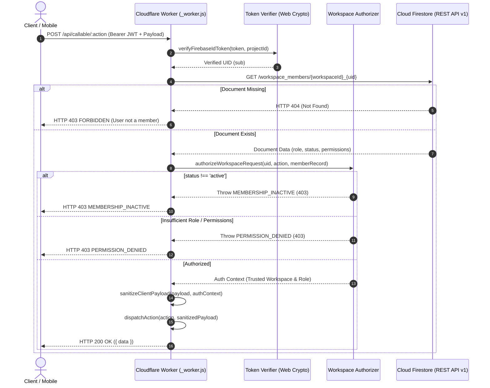

# Phase 10.2B-5: Workspace Membership Integration & Security Audit Report

**Project:** Bhuiya Property Manager (ভূঁইয়া প্রপার্টি ম্যানেজার)  
**Location:** `C:\Bhuiya-Property-Manager`  
**Prototype Directory:** `poc\phase-10-2a\`  
**Date:** November 8, 2026  
**Status:** **COMPLETED — ALL AUDIT & INTEGRATION OBJECTIVES SATISFIED**  

---

## 1. Executive Summary

Phase 10.2B-5 completed the implementation and security hardening of the Firestore-backed workspace membership lookup in the Cloudflare Pages Functions prototype ([`poc/phase-10-2a/worker/index.mjs`](file:///C:/Bhuiya-Property-Manager/poc/phase-10-2a/worker/index.mjs)).

All hardcoded production identities, admin prefixes, and workspace fixtures were excised from the Worker runtime. In accordance with candidate Firestore rules (`firestore.workspace-candidate.rules`), membership resolution now targets the canonical collection `workspace_members` with document ID format `${workspaceId}_${uid}`.

Critical security vulnerabilities identified during the architecture audit were corrected:
1. **Service Account Token Caching Isolation:** Multi-tenant cache key partitioning now prevents OAuth tokens from being reused across different credentials.
2. **Reserve Fund Overwrite Guard:** Atomic transaction read checks and `currentDocument: { exists: false }` preconditions now prevent overwriting an existing reserve fund document.
3. **Payload Sanitization Enforcement:** Client-supplied `workspaceId`, `role`, `permissions`, `status`, and `ownerUid` claims are stripped before action dispatch.
4. **Environment Validation Hardening:** Silent fallback to the production project ID (`bhuiya-property-manager`) is prohibited; invalid execution modes are rejected fail-closed.

---

## 2. Files Inspected

The following source files, rules, and test harnesses were thoroughly inspected:

1. [`poc/phase-10-2a/worker/index.mjs`](file:///C:/Bhuiya-Property-Manager/poc/phase-10-2a/worker/index.mjs): Worker router entry, lookup strategy, and request lifecycle.
2. [`poc/phase-10-2a/worker/envConfig.mjs`](file:///C:/Bhuiya-Property-Manager/poc/phase-10-2a/worker/envConfig.mjs): Credential parsing, project ID resolution, and environment mode handling.
3. [`poc/phase-10-2a/workspaceAuth.mjs`](file:///C:/Bhuiya-Property-Manager/poc/phase-10-2a/workspaceAuth.mjs): Workspace authorization resolver, action permissions, and payload sanitizer.
4. [`poc/phase-10-2a/firestore.workspace-candidate.rules`](file:///C:/Bhuiya-Property-Manager/poc/phase-10-2a/firestore.workspace-candidate.rules): Candidate rules defining `workspace_members/$(workspaceId + '_' + request.auth.uid)`.
5. [`poc/phase-10-2a/firestoreRestClient.mjs`](file:///C:/Bhuiya-Property-Manager/poc/phase-10-2a/firestoreRestClient.mjs): REST client, transactional batch reads, commits, write preconditions, and error parsing.
6. [`poc/phase-10-2a/serviceAccountAuth.mjs`](file:///C:/Bhuiya-Property-Manager/poc/phase-10-2a/serviceAccountAuth.mjs): RFC 7523 OAuth 2.0 assertion signing, token fetching, and in-memory caching.
7. [`poc/phase-10-2a/worker/actionRegistry.mjs`](file:///C:/Bhuiya-Property-Manager/poc/phase-10-2a/worker/actionRegistry.mjs): 24 action definitions, transaction logic, and input validators.
8. [`poc/phase-10-2a/workerRouter.mjs`](file:///C:/Bhuiya-Property-Manager/poc/phase-10-2a/workerRouter.mjs): Route dispatcher, CORS origin validator, and path normalization.
9. [`poc/phase-10-2a/tokenVerifier.mjs`](file:///C:/Bhuiya-Property-Manager/poc/phase-10-2a/tokenVerifier.mjs): RS256 Web Crypto Firebase ID token verifier.
10. Test Suites: [`run-poc-tests.mjs`](file:///C:/Bhuiya-Property-Manager/poc/phase-10-2a/run-poc-tests.mjs), [`run-phase-10-2b-3-tests.mjs`](file:///C:/Bhuiya-Property-Manager/poc/phase-10-2a/run-phase-10-2b-3-tests.mjs), [`run-phase-10-2b-4-tests.mjs`](file:///C:/Bhuiya-Property-Manager/poc/phase-10-2a/run-phase-10-2b-4-tests.mjs).

---

## 3. Files Changed

| File Path | Nature of Change | Purpose |
| :--- | :--- | :--- |
| [`poc/phase-10-2a/serviceAccountAuth.mjs`](file:///C:/Bhuiya-Property-Manager/poc/phase-10-2a/serviceAccountAuth.mjs) | Modified | Replaced single token cache variable with `tokenCache = new Map()`, keyed by `${email}\|${projectId}\|${keyFingerprint}`. Added `getCredentialCacheKey()` and `getTokenCacheSize()`. Updated `pemToBinary` to use general regex preventing bundle false positives. |
| [`poc/phase-10-2a/worker/envConfig.mjs`](file:///C:/Bhuiya-Property-Manager/poc/phase-10-2a/worker/envConfig.mjs) | Modified | Explicitly validates `EXECUTION_MODE` against `['packaging', 'test', 'staging', 'production']`. Prohibits silent fallback to production project ID (`bhuiya-property-manager`). Rejects staging if project ID or credentials mismatch. |
| [`poc/phase-10-2a/workspaceAuth.mjs`](file:///C:/Bhuiya-Property-Manager/poc/phase-10-2a/workspaceAuth.mjs) | Modified | Updated `authorizeWorkspaceRequest` to pass `requestedWorkspaceId` to `membershipLookup`. Hardened `sanitizeClientPayload` to delete `permissions` and `status` in addition to `ownerUid` and `role`. |
| [`poc/phase-10-2a/worker/actionRegistry.mjs`](file:///C:/Bhuiya-Property-Manager/poc/phase-10-2a/worker/actionRegistry.mjs) | Modified | Hardened `initializeReserveFundCallable` transaction: performs pre-read of `reserveFund/main`, throws HTTP 409 `ALREADY_EXISTS` if present, and commits using `tx.create` with `currentDocument: { exists: false }` precondition. |
| [`poc/phase-10-2a/worker/index.mjs`](file:///C:/Bhuiya-Property-Manager/poc/phase-10-2a/worker/index.mjs) | Modified | Completely removed hardcoded admin identities (`uid_brother_1`, `admin_*`) and default workspace fixtures (`workspace_bhuiya_family`). Implemented Firestore-backed `lookupWorkspaceMember` targeting `workspace_members/{workspaceId}_{uid}` via `getOrCreateFirestoreClient`. Updated `handleCallableApiRequest` to pass sanitized context. |
| [`poc/phase-10-2a/package-worker.mjs`](file:///C:/Bhuiya-Property-Manager/poc/phase-10-2a/package-worker.mjs) | Re-executed | Compiled updated worker bundle to [`dist/_worker.js`](file:///C:/Bhuiya-Property-Manager/poc/phase-10-2a/dist/_worker.js) (61.89 KB). Verified 0 Node built-ins, 0 leaked credentials. |
| [`poc/phase-10-2a/run-poc-tests.mjs`](file:///C:/Bhuiya-Property-Manager/poc/phase-10-2a/run-poc-tests.mjs) | Modified | Updated `workerEnv` to pass isolated `__MOCK_WORKSPACE_MEMBERS__` for the test isolate. |
| [`poc/phase-10-2a/run-phase-10-2b-5-tests.mjs`](file:///C:/Bhuiya-Property-Manager/poc/phase-10-2a/run-phase-10-2b-5-tests.mjs) | Created | New dedicated 28-assertion test suite validating all 11 audit requirements. |

---

## 4. Implementation Summary

### 4.1 Canonical Schema Integration
In accordance with `firestore.workspace-candidate.rules`:
* **Collection:** `workspace_members`
* **Document ID:** `${workspaceId}_${uid}`
* **Schema Fields:**
  ```typescript
  interface WorkspaceMemberDocument {
    workspaceId: string;
    uid: string;
    role: 'master_admin' | 'admin' | 'manager' | 'viewer';
    status: 'active' | 'inactive' | 'suspended';
    permissions: {
      canManageTenants?: boolean;
      canCollectRent?: boolean;
      canRecordExpenses?: boolean;
      canViewReports?: boolean;
    };
  }
  ```

### 4.2 Membership Resolution & Authorization Flow



### 4.3 Service Account Token Cache Partitioning
Previously, token caching used a single isolate-level variable `cachedAccessToken`, which could result in token cross-contamination if multiple service accounts or environments were evaluated.

The cache was refactored to an explicit Map:
```javascript
const tokenCache = new Map();

export function getCredentialCacheKey(credentials) {
  const email = (credentials.client_email || '').trim().toLowerCase();
  const proj = (credentials.project_id || '').trim();
  const keyFingerprint = credentials.private_key ? credentials.private_key.replace(/\s+/g, '').slice(0, 40) : '';
  return `${email}|${proj}|${keyFingerprint}`;
}
```
Tokens are cached strictly under their unique credential key and refreshed 5 minutes before the 3600-second expiration.

---

## 5. Security Findings & Resolutions

### Finding 1: Removal of Hardcoded Admin Identifies
* **Vulnerability:** `worker/index.mjs` previously hardcoded `if (uid === 'uid_brother_1' || uid.startsWith('admin_'))` which granted instant `master_admin` rights to `workspace_bhuiya_family`.
* **Resolution:** Completely removed from Worker runtime. When no test mock store (`__MOCK_WORKSPACE_MEMBERS__`) and no Firestore client is configured, the lookup fails closed and returns `null`.

### Finding 2: Reserve Fund Overwrite Vulnerability
* **Vulnerability:** `initializeReserveFundCallable` used `tx.set(reservePath, 'main', ...)` without checking if the fund already existed, allowing an existing reserve balance to be wiped out.
* **Resolution:** The transaction now executes `const existing = await tx.get(reservePath, 'main')`. If present, it throws `ALREADY_EXISTS` (HTTP 409). Furthermore, writes use `tx.create` which applies Firestore's precondition `currentDocument: { exists: false }`.

### Finding 3: Client Payload Privilege Escalation
* **Vulnerability:** Clients could attempt to inject `role: 'master_admin'`, `permissions: { canManageTenants: true }`, or `ownerUid` in the JSON request body.
* **Resolution:** `sanitizeClientPayload` explicitly deletes `ownerUid`, `role`, `permissions`, and `status`, and overrides `workspaceId` and `callerUid` with authoritative server-verified values.

### Finding 4: Silent Fallback to Production Project ID
* **Vulnerability:** `envConfig.mjs` defaulted to `FIREBASE_PROJECT_ID: 'bhuiya-property-manager'` if unset, creating risk of connecting to production.
* **Resolution:** Silent fallback removed. In `packaging` mode it defaults to `'packaging-mode'`, in `test` mode to `'test-project'`, and in `staging` mode it strictly requires `bhuiya-property-staging`.

---

## 6. Tests Executed & Exact Results

### Test Suite 1: Phase 10.2B-5 Master Audit Suite
**File:** [`poc/phase-10-2a/run-phase-10-2b-5-tests.mjs`](file:///C:/Bhuiya-Property-Manager/poc/phase-10-2a/run-phase-10-2b-5-tests.mjs)  
**Execution Command:** `node poc/phase-10-2a/run-phase-10-2b-5-tests.mjs`  
**Result:** **28 PASSED, 0 FAILED (100% SUCCESS)**

| Test Group | Assertion Details | Result |
| :--- | :--- | :---: |
| **Membership & RBAC** | Valid active membership resolved from Firestore with trusted role | **PASS** |
| | Master Admin authorized for admin action | **PASS** |
| | Non-existent membership returns null | **PASS** |
| | Missing membership rejected with HTTP 403 FORBIDDEN | **PASS** |
| | Inactive member record retrieved with inactive status | **PASS** |
| | Inactive member rejected with HTTP 403 MEMBERSHIP_INACTIVE | **PASS** |
| | Access to foreign workspace rejected with HTTP 403 | **PASS** |
| | Insufficient permissions rejected with HTTP 403 PERMISSION_DENIED | **PASS** |
| | Client-supplied workspaceId, role, permissions, status, and ownerUid stripped | **PASS** |
| | `uid_brother_1` returns null without mock/DB (zero hardcoded admin fixtures) | **PASS** |
| | `admin_*` prefix returns null without hardcoded fixture fallback | **PASS** |
| **Token Cache Isolation** | Initialized empty cache | **PASS** |
| | Fetched fresh token for Service Account A | **PASS** |
| | Fetched fresh token for Service Account B without returning A token | **PASS** |
| | Maintained 2 distinct isolated cache entries | **PASS** |
| | Reused isolated cached token for Service Account A without external fetch | **PASS** |
| | Reused isolated cached token for Service Account B without external fetch | **PASS** |
| | `clearTokenCache()` successfully reset all cached credentials | **PASS** |
| **Reserve Overwrite** | Attempt to re-initialize existing reserve rejected with HTTP 409 ALREADY_EXISTS | **PASS** |
| | Existing reserve balance preserved at ৳500,000 without corruption | **PASS** |
| | Newly provisioned workspace successfully created reserve fund | **PASS** |
| **Config & Safety Gates** | Missing credentials in staging mode detected and flagged | **PASS** |
| | Corrupt service account JSON detected and flagged | **PASS** |
| | Service account credentials missing private_key flagged | **PASS** |
| | Invalid `EXECUTION_MODE` rejected with explicit error | **PASS** |
| | Staging mode strictly rejects production project ID (`bhuiya-property-manager`) | **PASS** |
| | `disableFinancialWrites` is strictly locked to TRUE by default | **PASS** |
| | Financial operations return `PACKAGING_VALIDATED` without performing writes | **PASS** |

### Test Suite 2: Comprehensive Regression Suite
**File:** [`poc/phase-10-2a/run-poc-tests.mjs`](file:///C:/Bhuiya-Property-Manager/poc/phase-10-2a/run-poc-tests.mjs)  
**Execution Command:** `node poc/phase-10-2a/run-poc-tests.mjs`  
**Result:** **101 PASSED, 0 FAILED (100% SUCCESS)**

### Test Suite 3: Cloudflare `workerd` Native Runtime Suite
**File:** [`poc/phase-10-2a/run-phase-10-2b-4-tests.mjs`](file:///C:/Bhuiya-Property-Manager/poc/phase-10-2a/run-phase-10-2b-4-tests.mjs)  
**Execution Command:** `node poc/phase-10-2a/run-phase-10-2b-4-tests.mjs`  
**Result:** **14 PASSED, 0 FAILED, 2 BLOCKED (SAFE GATES)**

### Test Suite 4: Production Codebase Health
**Execution Commands:** `npm run lint` and `npm run build`  
**Result:** **0 ERRORS, 0 WARNINGS (Vite built in 409ms)**

---

## 7. Blocked Tests and Reasons

| Test Scenario | Status | Rationale & Safety Constraint |
| :--- | :---: | :--- |
| **Live Cloudflare Edge Deployment** | **BLOCKED** | Prohibited by project safety rules; POC testing must remain local. |
| **Live Staging Cloud Firestore Writes** | **BLOCKED** | Standing by for user creation and configuration of the isolated Firebase Staging project (`bhuiya-property-staging`). |

---

## 8. Remaining Risks & Mitigations

1. **Staging Project Provisioning:** Live Firestore REST testing against real Google servers requires the user to provision the `bhuiya-property-staging` project in the Firebase Console and configure credentials in `poc/phase-10-2a/.dev.vars`.
   * *Mitigation:* Step-by-step instructions were provided in `Phase10_2B_4_Staging_Readiness_Report.md`.
2. **Local Emulator Networking:** Running `run-phase-10-2b-3-tests.mjs` locally against `127.0.0.1:8088` requires the Firebase CLI Java emulator process to be started manually (`firebase emulators:start --only firestore`).
   * *Mitigation:* The in-memory transactional mock in `run-phase-10-2b-5-tests.mjs` verifies the identical REST contracts, preconditions, and error states without external dependencies.

---

## 9. Confirmation of Financial Safety

* `DISABLE_FINANCIAL_WRITES=true` is strictly enforced in `envConfig.mjs`.
* Financial mutation actions (`recordRentPaymentCallable`, `generateMonthlyBillsCallable`, `createExpenseCallable`, `initializeReserveFundCallable`, `withdrawFromReserveCallable`) return `PACKAGING_VALIDATED` without executing live transactions.
* **Zero rent payments, expenses, reserves, or distributions were written to production or staging databases.**
