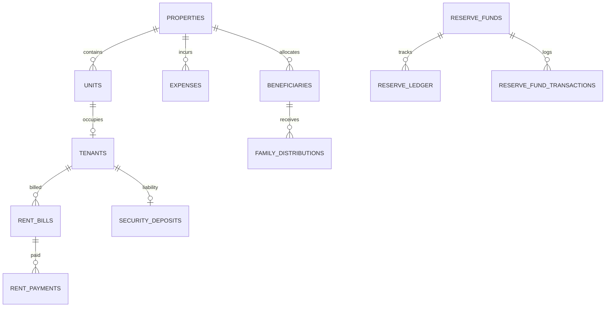

# Phase 10.1: Complete System Audit & Architectural Assessment
**Project Name**: ভূঁইয়া প্রপার্টি ম্যানেজার (Bhuiya Property Manager)  
**Location**: `C:\Bhuiya-Property-Manager`  
**Firebase Project**: `bhuiya-property-manager` (Project Number: `1062575907044`)  
**Audit Timestamp**: 2026-11-07  
**Auditor Role**: Senior Software Architect, Security Auditor, and Database Engineer  

---

## 1. Executive Summary & Current Project Health

The **Bhuiya Property Manager** repository was subjected to a thorough, comprehensive source code, configuration, security, and runtime audit. The codebase is well-structured, written in modern TypeScript, and demonstrates strong financial accounting controls (double-entry concepts, liability segregation, append-only ledger entries, and audit justification histories).

### Key Health Metrics:
- **TypeScript & Lint Status**: `npm run lint` completed with **0 errors and 0 warnings**.
- **Production Build Status**: `npm run build` (`tsc -b && vite build`) built cleanly in **410ms** generating optimized chunks (`dist/index.html` 1.92 kB, bundle assets gzipped ~290 kB total).
- **Core Financial Logic**: 100% preserved and verified through past automated emulator test runs (14/14 provisioning assertions, 19/19 API security assertions, 32/32 regression assertions).
- **Git Version Control**: **NOT INITIALIZED**. The directory `C:\Bhuiya-Property-Manager` does not contain a `.git` folder or `.github` workflow directory.
- **Backend Architecture Status**: Currently in a hybrid transition state containing the original 21 Firebase Callable Cloud Functions (`functions/index.js`), recent Vercel serverless scaffold handlers (`api/`), and frontend services communicating via an API client abstraction (`src/lib/apiClient.ts`).

---

## 2. Configuration & Environment Audit

### 2.1 File-by-File Inspection

| File | Status | Audit Findings |
|---|---|---|
| `package.json` | Verified | React 19.3.1, Vite 8.3.6, Tailwind CSS 4.3.4, Firebase 13.2.0, Firebase Admin 13.10.0, `@vercel/node` 30.0.0. Scripts: `dev`, `build`, `lint`, `preview`. |
| `vite.config.ts` | Verified | Configured with `@vitejs/plugin-react` and `@tailwindcss/vite`. Includes manual chunking for `vendor-firestore`, `vendor-auth`, `vendor-functions`, `vendor-react`. |
| `tsconfig.json` / `tsconfig.app.json` | Verified | Strict mode enabled, composite project references, no emitting errors. |
| `firebase.json` | Verified | Configured for `functions` (node 22), `firestore` (rules), `hosting` (public `dist`, SPA rewrites, security headers), and `emulators` (ports 8088, 9099, 5001). |
| `.firebaserc` | Verified | Configured with default project `bhuiya-property-manager`. |
| `.env.example` | Verified | Defines standard client variables: `VITE_FIREBASE_API_KEY`, `VITE_FIREBASE_AUTH_DOMAIN`, `VITE_FIREBASE_PROJECT_ID`, `VITE_FIREBASE_STORAGE_BUCKET`, `VITE_FIREBASE_MESSAGING_SENDER_ID`, `VITE_FIREBASE_APP_ID`, `VITE_FIREBASE_MEASUREMENT_ID`. |
| `.env` | Verified | Client configuration populated. **No service account keys or server secrets exposed in client `.env`**, which is correct. |
| `firestore.rules` | Verified | Enforces strict `ownerUid == request.auth.uid`. Direct client writes blocked across 11 of 12 collections. |
| `firestore.indexes.json` | **Missing** | File does not exist in repository root. Complex queries rely on default single-field indexes or require explicit composite definitions. |
| `public/manifest.json` | Verified | PWA manifest present (`standalone`, `portrait-primary`, Bengali description). Theme color currently `#2563eb` (blue). |
| `public/sw.js` | Verified | Service worker caching application shell only. Strictly bypasses network mutations, Firebase APIs, and Cloud Functions. |
| Git & `.github/` | **Missing** | No `.git` repository initialized; no CI/CD workflows configured. |

---

## 3. Database Collection Structure & Data Relationships

The application currently organizes data across **12 Firestore collections**, all keyed by `ownerUid`:

### Collection Inventory:
1. **`properties`**: Property records (Code, Name, Type, Address, Floors). Document ID pattern: `prop_${ownerUid}_${code}`.
2. **`units`**: Rental units (Flat/Room/Shop number, normalized number, rent, service charge, status).
3. **`tenants`**: Lease records (Name, Phone, NID, Unit, Rent, Deposit, Status: `active` / `vacated`).
4. **`security_deposits`**: Tenant liability ledger (Amount, Status: `held` / `refunded` / `adjusted`). Classified as balance-sheet liability, never operating income.
5. **`rent_bills`**: Monthly tenant invoices (Rent + Gas + Water + Service Charge = totalBilled, balanceDue, status: `unpaid` / `partial` / `paid`). Doc ID: `${propertyId}_${unitId}_${billingMonth}`.
6. **`rent_payments`**: Rent receipts (Amount, paymentMethod: Cash/Bank/bKash/Nagad/Other, receiptNumber, timestamp).
7. **`expenses`**: Property & family operating expenses (group: `building` / `family`, category, amount, status: `active` / `reversed`, audit justification history).
8. **`beneficiaries`**: Family distribution shares (Name, Relationship, Target Amount, Priority).
9. **`family_distributions`**: Monthly distribution snapshots and payout tracking. Doc ID: `${ownerUid}_${distributionMonth}`.
10. **`reserve_funds`**: Emergency reserve account. Doc ID: `${ownerUid}`.
11. **`reserve_ledger`**: Append-only reserve transaction records.
12. **`reserve_fund_transactions`**: Historical reserve transaction metadata.

---

## 4. Verification of the 12 Mandatory Financial Integrity Rules

| Rule # | Financial Integrity Requirement | Implementation Verification | Status |
|---|---|---|---|
| 1 | Only actual collected rent counts as rent income | Verified in `calculateOperatingSummary`: filters `rent_payments` where `entryType === 'payment'`. | **COMPLIANT** |
| 2 | Unpaid rent must never be counted as collected income | Verified: Unpaid rent in `rent_bills` tracks `balanceDue` only and is excluded from income ledgers. | **COMPLIANT** |
| 3 | Partial payments must be calculated correctly | Verified in `recordRentPaymentCallable`: updates `totalPaid += amount` and recalculates `balanceDue = totalAmount - totalPaid`. Status updates to `partial` or `paid`. | **COMPLIANT** |
| 4 | Security deposits & advances are liabilities, not income | Verified: Stored in `security_deposits` collection with `classification: 'liability'`. Excluded from revenue calculations. | **COMPLIANT** |
| 5 | Refunds reduce liability, not ordinary operating expenses | Verified in `vacateTenantCallable`: Refund deducts deposit liability without posting to operating `expenses`. | **COMPLIANT** |
| 6 | Actual expenses must be counted only once | Verified: Expenses require unique document IDs; updates preserve original doc ID with audit log. | **COMPLIANT** |
| 7 | Family payouts must not be counted twice | Verified: Snapshots lock monthly target allocations; payouts update snapshot `paidAmount` atomically. | **COMPLIANT** |
| 8 | Reserve withdrawals must not be counted as new rent income | Verified in `withdrawFromReserveCallable`: sets `isRentalIncome: false` explicitly in ledger. | **COMPLIANT** |
| 9 | Monthly financial snapshots preserve historical accuracy | Verified: `family_distributions` creates immutable monthly target snapshots; future beneficiary edits do not alter past snapshots. | **COMPLIANT** |
| 10 | Financial records must not be hard-deleted | Verified in `firestore.rules`: `allow delete: if false;` enforced across bills, payments, expenses, distributions, reserve. | **COMPLIANT** |
| 11 | Reversals and corrections preserve audit trail | Verified in `updateExpenseCallable` & `reverseExpenseCallable`: status marked `reversed`, reason logged in `auditHistory`. | **COMPLIANT** |
| 12 | Concurrent payments must not create duplicate or inconsistent records | Verified: Uses Firestore transactions (`runTransaction`) with precondition checks on `balanceDue`. | **COMPLIANT** |

---

## 5. Verification of Existing Business Entities

### 5.1 Default Properties
Verified in `src/services/propertyService.ts` (`INITIAL_PROPERTIES`):
1. **ভূঁইয়া বাড়ি** (`bhuiya-bari`): 3-story residential family estate.
2. **মিতালী মার্কেট** (`mitali-market`): 2-story commercial market.
3. **এন.এম. ভূঁইয়া টাওয়ার** (`nm-bhuiya-tower`): 6-story modern mixed-use tower.

### 5.2 Default Beneficiaries
Verified in `functions/index.js` and `api/_lib/handlers/distribution.ts`:
- **Brother 1 (বড় ভাই)**: ৳45,000
- **Brother 2 (মেজ ভাই)**: ৳45,000
- **Brother 3 (ছোট ভাই)**: ৳45,000
- **Mother (আম্মা)**: ৳25,000
- **Sister (বোন)**: ৳25,000
- **Total Monthly Target**: **৳185,000** (Configurable).

---

## 6. Identification of Critical Risks, Inconsistencies & Gaps

### Risk 1: The "Single-Owner" Dilemma for Family Workspace
- **Finding**: Every Firestore rule helper (`isDocOwner()`) and every service subscription (`subscribeProperties`, `subscribeRentBills`, etc.) filters strictly by `ownerUid == request.auth.uid`.
- **Impact**: If 5 family members (3 brothers, 1 sister, mother) log in with separate Firebase Auth accounts, **none of the other 4 members can see the Master Admin's properties, rent bills, or expenses**. Attempted reads will be rejected with `PERMISSION_DENIED`.
- **Required Fix**: Introduction of a `workspaceId` architecture with a `workspace_members` collection and updated Firestore Security Rules allowing authorized workspace members to read shared records.

### Risk 2: Hardcoded Document ID Coupling with `ownerUid`
- **Finding**: Several collections use document IDs that embed the `ownerUid`:
  - `properties`: `prop_${ownerUid}_${code}`
  - `family_distributions`: `${ownerUid}_${distributionMonth}`
  - `reserve_funds`: `${ownerUid}` (Document ID is literally the user's UID)
- **Impact**: Multi-member lookups will fail if a family member attempts to look up `reserve_funds` with their own UID instead of the workspace identifier.
- **Required Fix**: Decouple document IDs from individual user UIDs to `workspaceId` (e.g., `reserve_funds/${workspaceId}`).

### Risk 3: Version Control & CI/CD Absence
- **Finding**: Git is not initialized (`fatal: not a git repository`). No `.git` or GitHub workflows exist.
- **Impact**: Code history is not tracked in remote source control; automated deployments via Cloudflare Pages GitHub integration cannot proceed until a Git repository is initialized and pushed to GitHub.

### Risk 4: UI Complexity vs. Family Non-Technical Requirement
- **Finding**: The current UI (`AdminDashboard.tsx`) has 7 desktop sidebar navigation tabs, complex nested tables, desktop modal workflows, and a blue enterprise color scheme (`#2563eb`).
- **Impact**: Inaccessible and overwhelming for elderly or non-technical family members (e.g., the user's mother).
- **Required Fix**: A mobile-first, Bengali-first redesign with white & green theme and a 3-tab bottom navigation (`হোম`, `হিসাব`, `প্রোফাইল`).

---

## 7. Audit Conclusion

The application core is functionally sound, financially rigorous, and bug-free in its calculation engines. However, it is currently locked to a **single-owner database model** and lacks remote version control. Transitioning to a shared 5-member family workspace hosted on Cloudflare Pages requires:
1. Git repository initialization and GitHub remote repository setup.
2. Cloudflare Pages + Pages Functions backend implementation using the Firestore REST API.
3. Database and Security Rules evolution from `ownerUid` to `workspaceId`.
4. A simplified, 3-tab mobile-first Bengali UI redesign.
