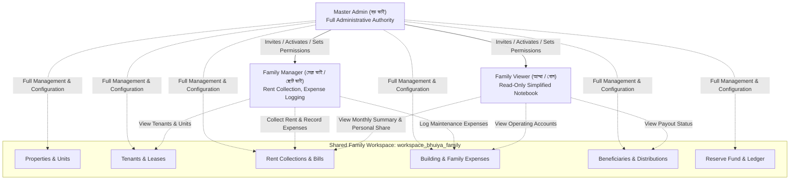
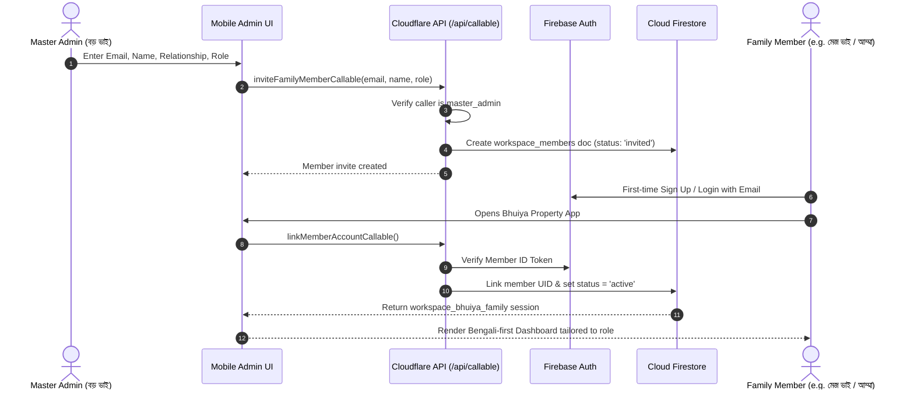

# Phase 10.1: Family Workspace Architecture & Multi-User Design
**Project Name**: ভূঁইয়া প্রপার্টি ম্যানেজার (Bhuiya Property Manager)  
**Location**: `C:\Bhuiya-Property-Manager`  
**Target Users**: 5 Family Members (3 Brothers, 1 Sister, Mother)  
**Audit Timestamp**: 2026-11-07  

---

## 1. Overview & Objective

The Bhuiya Property estate is owned and operated by five core family members:
- **Brother 1 (বড় ভাই)**: Estate Master Administrator
- **Brother 2 (মেজ ভাই)**: Family Co-Manager / Rent Collector
- **Brother 3 (ছোট ভাই)**: Family Co-Manager / Operations
- **Mother (আম্মা)**: Respected Elder & Family Beneficiary (View-Only / Simplified Ledger)
- **Sister (বোন)**: Family Beneficiary (View-Only / Simplified Ledger)

All 5 family members will log in from their own mobile phones using individual Firebase Authentication credentials (email/password). They must access **the same shared family estate workspace** and view the identical, authoritative financial data corresponding to their assigned permissions.

---

## 2. Analysis: Why the Existing Database Model Fails Multi-User Access

In the current application architecture:
1. Every collection document contains `ownerUid: string`.
2. Document IDs in multiple collections are hardcoded to the user's UID:
   - `properties`: `prop_${ownerUid}_${code}`
   - `family_distributions`: `${ownerUid}_${distributionMonth}`
   - `reserve_funds`: `${ownerUid}` (The document ID literally matches the user's UID)
3. `firestore.rules` enforces:
   ```javascript
   function isDocOwner() {
     return isAuthenticated() &&
            resource != null &&
            ('ownerUid' in resource.data) &&
            resource.data.ownerUid == request.auth.uid;
   }
   ```
4. Frontend services subscribe using:
   `where('ownerUid', '==', user.uid)`

### Impact on Multi-User Login:
If Brother 2 or Mother logs in with their own Firebase Auth account, Firestore rules evaluate `resource.data.ownerUid == request.auth.uid` as **FALSE**. Their mobile app will either:
- Return 0 records (empty dashboard), OR
- Throw `7 PERMISSION_DENIED` errors on all reads and writes.

**Conclusion**: The database must evolve from an individual `ownerUid` isolation model to a **shared `workspaceId` relationship model**.

---

## 3. Account Hierarchy & Role-Based Access Control (RBAC)



### Role Definitions:
1. **`master_admin`**: Complete ownership of the workspace. Can add/remove members, assign permissions, configure default properties and beneficiaries, execute reserve withdrawals, and customize UI menus.
2. **`family_manager`**: Active operational role (typically co-managing brothers). Can record rent payments, log building/family expenses, register tenants, and view all reports. Cannot delete properties or alter reserve fund opening balances.
3. **`family_viewer`**: Read-only, simplified view (tailored for Mother and Sister). Can inspect monthly rent collection totals, operating balance, their personal family distribution share, and view receipts. Cannot mutate any financial or lease records.

---

## 4. Granular Permission Matrix

| Capability / Action | `master_admin` | `family_manager` | `family_viewer` |
|---|:---:|:---:|:---:|
| **View Dashboard Overview** | Yes | Yes | Yes (Simplified) |
| **View Monthly Statements & Ledger** | Yes | Yes | Yes |
| **Collect Rent & Issue Receipts** | Yes | Yes | No |
| **Generate Monthly Rent Bills** | Yes | Yes | No |
| **Create & Register Tenants** | Yes | Yes | No |
| **Vacate Tenants & Settle Deposits** | Yes | Yes | No |
| **Record Building & Family Expenses** | Yes | Yes | No |
| **Edit / Reverse Operating Expenses** | Yes | Requires Justification | No |
| **View Beneficiaries & Distributions** | Yes | Yes | Yes (Personal Payout) |
| **Update Beneficiary Targets** | Yes | No | No |
| **Record Beneficiary Payouts** | Yes | Yes (With Approval) | No |
| **Deposit to Reserve Fund** | Yes | Yes | No |
| **Withdraw from Reserve Fund** | Yes | No | No |
| **Add / Deactivate Family Members** | Yes | No | No |
| **Configure Visible Menus & Actions** | Yes | No | No |
| **Export Excel / CSV Reports** | Yes | Yes | Yes |

---

## 5. Database Schema Evolution: From `ownerUid` to `workspaceId`

### 5.1 New Root Collections

#### Collection: `workspaces`
- **Document ID**: `workspace_bhuiya_family`
- **Fields**:
  ```typescript
  interface WorkspaceDocument {
    id: string; // 'workspace_bhuiya_family'
    name: string; // 'ভূঁইয়া পরিবার এস্টেট'
    code: string; // 'bhuiya-family'
    masterAdminUid: string; // Primary estate owner UID
    createdAt: Timestamp;
    updatedAt: Timestamp;
    status: 'active' | 'archived';
    settings: {
      currency: 'BDT';
      defaultBillingDay: 1;
      monthlyBuildingBudget: 60000;
      targetMonthlyDistribution: 185000;
      language: 'bn';
      themeColor: '#059669'; // Emerald Green
    };
  }
  ```

#### Collection: `workspace_members`
- **Document ID**: `${workspaceId}_${memberUid}`
- **Fields**:
  ```typescript
  interface WorkspaceMemberDocument {
    id: string;
    workspaceId: string; // 'workspace_bhuiya_family'
    uid: string; // Firebase Auth UID
    email: string;
    displayName: string; // 'বড় ভাই', 'মেজ ভাই', 'আম্মা', etc.
    relationship: 'brother' | 'mother' | 'sister' | 'admin';
    role: 'master_admin' | 'family_manager' | 'family_viewer';
    status: 'active' | 'invited' | 'deactivated';
    permissions: {
      canCollectRent: boolean;
      canRecordExpenses: boolean;
      canManageTenants: boolean;
      canManageBeneficiaries: boolean;
      canManageReserve: boolean;
      canViewFinancialReports: boolean;
      canCustomizeUI: boolean;
    };
    invitedAt: Timestamp;
    activatedAt: Timestamp;
    lastActiveAt?: Timestamp;
  }
  ```

### 5.2 Schema Adjustments across Existing Collections

Every document in the 12 existing collections receives a `workspaceId: 'workspace_bhuiya_family'` field while preserving `ownerUid` for backwards compatibility:

| Collection | Existing Document ID Pattern | Proposed Multi-User Document ID Pattern | Key Modifications |
|---|---|---|---|
| `properties` | `prop_${ownerUid}_${code}` | `prop_${workspaceId}_${code}` | Add `workspaceId`, `updatedByUid` |
| `units` | Auto-ID | Auto-ID | Add `workspaceId` |
| `tenants` | Auto-ID | Auto-ID | Add `workspaceId` |
| `security_deposits` | Auto-ID | Auto-ID | Add `workspaceId` |
| `rent_bills` | `${propertyId}_${unitId}_${month}` | `${propertyId}_${unitId}_${month}` | Add `workspaceId` |
| `rent_payments` | Auto-ID | Auto-ID | Add `workspaceId`, `recordedByUid` |
| `expenses` | Auto-ID | Auto-ID | Add `workspaceId`, `recordedByUid` |
| `beneficiaries` | `ben_${ownerUid}_${name}` | `ben_${workspaceId}_${code}` | Add `workspaceId`, `linkedMemberUid` |
| `family_distributions` | `${ownerUid}_${month}` | `${workspaceId}_${month}` | Add `workspaceId` |
| `reserve_funds` | `${ownerUid}` | `${workspaceId}` | Add `workspaceId`, doc ID decoupled from UID |
| `reserve_ledger` | Auto-ID | Auto-ID | Add `workspaceId`, `authorizedByUid` |
| `reserve_fund_transactions` | Auto-ID | Auto-ID | Add `workspaceId` |

---

## 6. Firestore Security Rules Design for Shared Workspace

To allow authorized family members to read and interact with shared records without opening data to arbitrary users, `firestore.rules` is upgraded with workspace-aware helper functions:

```javascript
rules_version = '2';
service cloud.firestore {
  match /databases/{database}/documents {

    function isAuthenticated() {
      return request.auth != null && request.auth.uid != null;
    }

    // Helper: Validates active membership in the target workspace
    function isWorkspaceMember(workspaceId) {
      let memberDocPath = /databases/$(database)/documents/workspace_members/$(workspaceId + '_' + request.auth.uid);
      return isAuthenticated() &&
             exists(memberDocPath) &&
             get(memberDocPath).data.status == 'active';
    }

    // Helper: Retrieves member role
    function getMemberRole(workspaceId) {
      let memberDocPath = /databases/$(database)/documents/workspace_members/$(workspaceId + '_' + request.auth.uid);
      return get(memberDocPath).data.role;
    }

    function isMasterAdmin(workspaceId) {
      return isWorkspaceMember(workspaceId) && getMemberRole(workspaceId) == 'master_admin';
    }

    function isAuthorizedReader() {
      return isAuthenticated() &&
             resource != null &&
             (('workspaceId' in resource.data && isWorkspaceMember(resource.data.workspaceId)) ||
              ('ownerUid' in resource.data && resource.data.ownerUid == request.auth.uid));
    }

    // 1. WORKSPACES & MEMBERSHIP
    match /workspaces/{workspaceId} {
      allow read: if isWorkspaceMember(workspaceId);
      allow write: if isMasterAdmin(workspaceId);
    }

    match /workspace_members/{memberId} {
      allow read: if isAuthenticated() &&
                     (resource.data.uid == request.auth.uid ||
                      isMasterAdmin(resource.data.workspaceId));
      allow write: if isAuthenticated() &&
                      isMasterAdmin(request.resource.data.workspaceId);
    }

    // 2. SHARED ESTATE RECORDS (Read-only from client, mutations via trusted API)
    match /properties/{propertyId} {
      allow read: if isAuthorizedReader();
      allow write: if false; // Cloudflare Pages Function only
    }

    match /units/{unitId} {
      allow read: if isAuthorizedReader();
      allow write: if false;
    }

    match /tenants/{tenantId} {
      allow read: if isAuthorizedReader();
      allow write: if false;
    }

    match /rent_bills/{billId} {
      allow read: if isAuthorizedReader();
      allow write: if false;
    }

    match /rent_payments/{paymentId} {
      allow read: if isAuthorizedReader();
      allow write: if false;
    }

    match /expenses/{expenseId} {
      allow read: if isAuthorizedReader();
      allow write: if false;
    }

    match /beneficiaries/{beneficiaryId} {
      allow read: if isAuthorizedReader();
      allow write: if false;
    }

    match /family_distributions/{distributionId} {
      allow read: if isAuthorizedReader();
      allow write: if false;
    }

    match /reserve_funds/{reserveFundId} {
      allow read: if isAuthorizedReader();
      allow write: if false;
    }

    match /reserve_ledger/{entryId} {
      allow read: if isAuthorizedReader();
      allow write: if false;
    }
  }
}
```

---

## 7. Family Member Onboarding & Invitation Workflow



### Safety Controls:
1. **Instant Revocation**: If a member's phone is lost or their status changes, the Master Admin can click "Deactivate" in the Profile screen. This immediately updates `status: 'deactivated'`, cutting off all read access in Firestore Rules and rejecting all API mutations instantaneously.
2. **Zero Auto-Join**: Arbitrary users who sign up with random emails cannot access or see the workspace.
3. **Data Loss Prevention**: Deactivating a member preserves all historical rent payments, expenses, and audit logs they ever submitted.
