# Phase 10.1: Free Architecture Validation & Edge Runtime Report
**Project Name**: ভূঁইয়া প্রপার্টি ম্যানেজার (Bhuiya Property Manager)  
**Location**: `C:\Bhuiya-Property-Manager`  
**Target Platform**: Cloudflare Pages (Hosting + Functions) + Firebase Spark (Auth + Firestore)  
**Cost Model**: 100% Free Tier Guaranteed (No Blaze, No Paid Third Parties)  
**Audit Timestamp**: 2026-11-07  

---

## 1. Architectural Mandate & Constraints

The goal of this architectural assessment is to establish a zero-cost, highly reliable production architecture for the Bhuiya family property accounting application.

### Strict Non-Negotiable Restrictions:
1. **No Firebase Blaze Plan**: The project must remain on the Firebase Spark (free) plan permanently. No Google Cloud credit card billing may be required.
2. **No Firebase Cloud Functions**: Node.js Cloud Functions (2nd Gen / 1st Gen) require Blaze plan activation and are strictly prohibited.
3. **No Firebase Hosting**: Frontend hosting must move to Cloudflare Pages.
4. **No Paid Cloudflare Add-ons**: The application must run within Cloudflare's Free Workers / Pages quota.
5. **No Vercel Lock-In**: Must operate cleanly on Cloudflare without external serverless intermediaries.
6. **No Compromise on Security or Financial Invariants**: Zero-trust authentication, atomic multi-document transactions, duplicate prevention, and immutable audit trails must remain strictly enforced.

---

## 2. Critical Edge Runtime Compatibility Investigation

The application currently has 21 backend mutation operations that previously executed in Node.js environments. Moving these backend operations to **Cloudflare Pages Functions (V8 Workers runtime)** requires verifying 10 critical compatibility dimensions:

### 2.1 The 10 Compatibility Inquiries

#### 1. Firebase Admin SDK Compatibility with Cloudflare Workers
- **Investigation**: Can the official `firebase-admin` Node.js package run directly inside Cloudflare Workers or Pages Functions?
- **Finding**: **NO. It is fundamentally incompatible.**
- **Reason**: The official Firebase Admin SDK depends on `@google-cloud/firestore`, which internally uses `google-gax` and `@grpc/grpc-js` for communication over HTTP/2 gRPC. Cloudflare Workers uses V8 isolates that do not support the low-level TCP sockets and HTTP/2 framing modules that `@grpc/grpc-js` requires.

#### 2. Node.js Compatibility Requirements (`nodejs_compat`)
- **Investigation**: Does enabling Cloudflare's `nodejs_compat` flag resolve the issue?
- **Finding**: **NO.** While `nodejs_compat` polyfills Node primitives like `Buffer`, `EventEmitter`, `AsyncLocalStorage`, and Web Crypto, Cloudflare's documentation confirms that it **does NOT implement native TCP sockets or HTTP/2 client framing** required by gRPC. Additionally, bundling `firebase-admin` produces a bundle size exceeding the Cloudflare Workers Free limit (1 MB compressed).

#### 3. Required Node.js APIs and Unsupported Runtime Dependencies
- **Investigation**: Which specific Node APIs cause the failure?
- **Finding**:
  - `http2`: Cloudflare Workers does not support client-side HTTP/2 framing.
  - `net` & `tls`: Raw socket creation required by gRPC transport is unsupported in V8 isolates without specialized TCP connect bindings.
  - `fs`, `child_process`: Used in Google Cloud auth discovery; completely unavailable in V8 isolates.

#### 4. Firestore REST API Compatibility
- **Investigation**: Can Cloudflare Pages Functions communicate with Cloud Firestore via its official REST API?
- **Finding**: **YES. 100% Compatible.**
- **Details**: Google provides the official Cloud Firestore REST API v1 (`https://firestore.googleapis.com/v1/projects/{projectId}/databases/(default)/documents`). Because Cloudflare Pages Functions natively support modern `fetch`, Web Streams, and JSON serialization, HTTP REST calls execute with native edge performance and zero dependency overhead.

#### 5. Firebase Authentication Token Verification
- **Investigation**: Can Firebase ID Tokens be verified at the edge without `admin.auth().verifyIdToken()`?
- **Finding**: **YES. 100% Compatible and faster than Admin SDK.**
- **Details**: Firebase ID Tokens are standard RS256-signed JSON Web Tokens. Google publishes its public signing certificates at:
  `https://www.googleapis.com/service_accounts/v1/jwk/securetoken@system.gserviceaccount.com`
  Using standard Web Crypto API (`crypto.subtle`) or the lightweight, zero-dependency `jose` library, Cloudflare Pages Functions can verify the token's RS256 signature, expiry (`exp`), audience (`aud == projectId`), and issuer (`iss == https://securetoken.google.com/{projectId}`) in **less than 2 milliseconds of CPU time**.

#### 6. Secure Service-Account Credential Handling
- **Investigation**: How can Cloudflare Pages Functions access Firestore with administrative authority without exposing secrets to the browser?
- **Finding**: **Fully Supported via Cloudflare Environment Secrets.**
- **Mechanism**:
  - The Firebase Service Account Private Key and Client Email are stored as encrypted environment secrets in Cloudflare Pages dashboard (`FIREBASE_SERVICE_ACCOUNT_KEY` or `FIREBASE_CLIENT_EMAIL` / `FIREBASE_PRIVATE_KEY`).
  - These values are NEVER bundled or transmitted to the client.
  - At the edge, a Cloudflare Function signs an OAuth2 JWT assertion using Web Crypto RS256 and exchanges it at `https://oauth2.googleapis.com/token` for a short-lived Google OAuth2 Access Token (scope `https://www.googleapis.com/auth/datastore`).
  - The access token is cached in memory across isolate invocations for its 1-hour lifespan, requiring only one token refresh per hour per worker instance!

#### 7. Transaction and Atomic-Write Support via REST API
- **Investigation**: Does Firestore REST API support ACID transactions and atomic multi-document writes?
- **Finding**: **YES. Full ACID Transaction Support.**
- **Details**:
  - **Atomic Multi-Document Writes**: `POST .../documents:commit` accepts an array of `writes` (up to 500 documents per batch) that execute atomically.
  - **ACID Read-Write Transactions**:
    1. Call `POST .../documents:beginTransaction` -> returns a base64 transaction identifier.
    2. Read required documents with `?transaction={id}`.
    3. Call `POST .../documents:commit` with the transaction ID and conditional update masks. If a concurrent writer modified the document, Firestore rejects the commit with HTTP 409 `ABORTED`.
    4. Call `POST .../documents:rollback` if business invariants fail during validation.

#### 8. Error Handling and Retry Behavior
- **Investigation**: How are transaction conflicts handled on the edge?
- **Finding**: When Firestore returns HTTP 409 with code `ABORTED`, Cloudflare Pages Functions execute an automated retry loop with exponential backoff and random jitter (up to 3 retries, totaling ~150ms). This replicates the internal retry logic of the Firebase Admin SDK.

#### 9. Cloudflare Workers Free CPU and Request Limits
- **Investigation**: Will the application stay within Cloudflare Pages Free Tier limits?
- **Finding**: **Easily. Usage is < 1% of the free quota.**
  - **Requests Quota**: 100,000 requests per day. For 5 family members, estimated maximum daily operations will not exceed 300 to 500 requests/day.
  - **CPU Time Limit**: 10 ms CPU time per request on Free tier.
    - *Crucial Fact*: Network wait time for external `fetch()` calls (Google OAuth, Firestore REST) does NOT count toward the 10 ms CPU limit.
    - Active CPU execution (Web Crypto JWT verification, JSON payload parsing, response formatting) takes **1.5 ms to 3.5 ms**, well under the 10 ms ceiling.
  - **Memory Limit**: 128 MB RAM (more than adequate for lightweight JSON payloads).
  - **Subrequests**: 50 subrequests per invocation (a full transaction uses 2 to 4 subrequests).

#### 10. Operation Without Firebase Blaze Plan
- **Investigation**: Can Cloud Firestore REST API and Firebase Authentication operate on the Spark plan?
- **Finding**: **YES. 100% Functional on Spark.**
- **Details**: The Firestore REST API and Firebase Auth REST APIs are core Google Cloud APIs that are fully enabled on the free Spark plan. No billing account is required. The Spark plan daily quotas (50,000 document reads, 20,000 document writes, 20,000 deletes, 1 GB storage) are more than 100x what the Bhuiya estate requires.

---

## 3. Comparison of Architectural Approaches

| Evaluation Criteria | Approach A: `firebase-admin` in Cloudflare Pages | Approach B: Firestore REST API in Cloudflare Pages | Approach C: Direct Client SDK + Firestore Rules |
|---|---|---|---|
| **Technical Feasibility** | **BROKEN** (gRPC/HTTP/2 crash in V8 isolate) | **EXCELLENT** (Standard Web Standards `fetch` + Web Crypto) | **FEASIBLE** for simple apps, **INSUFFICIENT** for financial ledger |
| **Security Posture** | N/A (Cannot run) | **EXCELLENT** (Zero client trust; credentials secret; verified server-side) | **POOR / HIGH RISK** (Client could manipulate amounts, bypass deposit liabilities) |
| **Free-Tier Compatibility** | Failed (Bundle size > 1MB, gRPC) | **100% Free** (Within Cloudflare & Firebase Spark limits) | **100% Free** (Uses client Firestore directly) |
| **Transaction Support** | Non-functional on Edge | **Full ACID Transactions** (`:beginTransaction` & `:commit`) | Prone to network disconnects & client race conditions |
| **Implementation Complexity** | Impossible without external Node proxy | **Clean & Modular** (Lightweight REST helper ~250 lines) | **Extremely Complex Rules** (Risk of rule loopholes or locked data) |
| **Audit & Reversal Integrity**| N/A | **Authoritative Server Audit Log** | Client can forge audit timestamps |
| **Recommendation** | **REJECTED** | **STRONGLY RECOMMENDED** | **REJECTED** for mutations |

---

## 4. Quota Consumption & Financial Budget Analysis

### Daily Quota Capacity vs. Projected Bhuiya Family Usage

```mermaid
xychart-beta
    title "Daily Capacity vs Projected Daily Usage (Logarithmic Scale)"
    x-axis ["CF Requests", "Firestore Reads", "Firestore Writes", "Firestore Storage (MB)"]
    y-axis "Daily Limits" 0 --> 100000
    bar [100000, 50000, 20000, 1024]
    bar [500, 800, 150, 15]
```

| Resource | Free Tier Limit | Estimated Daily Peak Usage | % Quota Consumed | Risk Assessment |
|---|---|---|---|---|
| **Cloudflare Dynamic Requests** | 100,000 / day | ~500 requests / day | **0.50%** | Zero risk |
| **Cloudflare Static Assets** | Unlimited | ~1,000 assets / day | **0.00%** | Zero risk |
| **Cloudflare CPU Time** | 10 ms / request | 2.5 ms / request | **25.00%** | Zero risk |
| **Firestore Document Reads** | 50,000 / day | ~800 reads / day | **1.60%** | Zero risk |
| **Firestore Document Writes** | 20,000 / day | ~150 writes / day | **0.75%** | Zero risk |
| **Firestore Storage** | 1,024 MB (1 GB) | ~15 MB (after 5 years) | **1.46%** | Zero risk |
| **Firebase Auth Users** | 50,000 MAU | 5 users | **0.01%** | Zero risk |

---

## 5. Recommended Free Architecture Blueprint

### Target Component Stack:
1. **Frontend Hosting**: **Cloudflare Pages** (Global CDN, instant builds, unlimited static bandwidth, custom domain support).
2. **Backend API**: **Cloudflare Pages Functions** (`/api/callable/[action].ts` running on Cloudflare Workers edge runtime).
3. **Database**: **Google Cloud Firestore (Spark Free Plan)** accessed via:
   - **Reads & Real-Time Sync**: Firebase Web Client SDK in browser, secured by owner/workspace Firestore Rules.
   - **All 21 Critical Financial Mutations**: Cloudflare Pages Functions calling Firestore REST API with service account credentials.
4. **Authentication**: **Firebase Authentication** (Email/Password), with client-side token issuance and server-side RS256 token verification on Cloudflare Edge via Google JWKS.
5. **Mobile PWA**: Modern Progressive Web App cached by application shell Service Worker, installable on Android and iOS.
6. **Source Control**: **GitHub** repository with automated Cloudflare Pages Git integration.

This architecture is **completely free, robust, highly available, and requires neither Firebase Blaze nor paid Cloudflare plans**.
