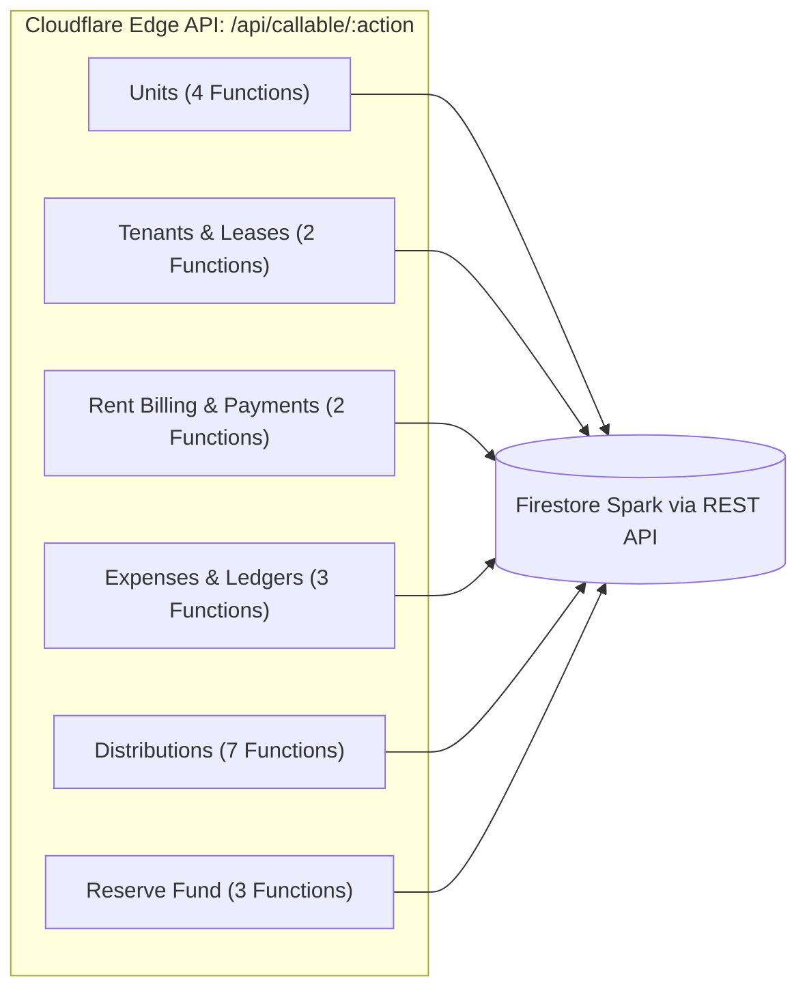

# Phase 10.1: Backend Function Migration & Frontend Mapping
**Project Name**: ভূঁইয়া প্রপার্টি ম্যানেজার (Bhuiya Property Manager)  
**Location**: `C:\Bhuiya-Property-Manager`  
**Target Architecture**: Cloudflare Pages Functions (`/api/callable/[action]`)  
**Audit Timestamp**: 2026-11-07  

---

## 1. Overview & Protocol Standard

To eliminate Firebase Blaze billing and migrate away from Firebase Cloud Functions, all **21 backend operations** must be mapped to Cloudflare Pages Functions. 

### Protocol Architecture:
- **Base Endpoint**: `POST /api/callable/:actionName`
- **Authentication**: `Authorization: Bearer <firebase_id_token>`
- **Token Verification**: Edge-native Web Crypto RS256 verification against Google Public JWKS (`https://www.googleapis.com/service_accounts/v1/jwk/securetoken@system.gserviceaccount.com`).
- **Authorization**: Caller UID extracted from verified token; role verified against `workspace_members`.
- **Database Driver**: Cloud Firestore REST API v1 (`https://firestore.googleapis.com/v1/...`) using Service Account OAuth2 Bearer token generated at the edge.
- **Frontend Client**: Standard HTTP `fetch` adapter (`src/lib/apiClient.ts`), fully compatible with the existing `httpsCallable(fn)(data)` signature.

---

## 2. Comprehensive Inventory of All 21 Functions



---

### GROUP 1: UNITS & PROPERTY LIFECYCLE (4 Functions)

#### 1. `createUnitCallable`
- **Purpose**: Creates a rental unit (flat, room, shop) inside a property, enforces normalized unit number uniqueness atomically, and updates the parent property's active unit list.
- **Input Schema**:
  ```typescript
  {
    workspaceId?: string;
    propertyId: string;
    unitNumber: string;
    type?: 'flat' | 'room' | 'shop';
    floor?: number;
    monthlyRent?: number;
    serviceCharge?: number;
    notes?: string;
    electricityMeterNumber?: string;
    gasMeterNumber?: string;
  }
  ```
- **Output Schema**: `{ success: true, unitId: string, normalizedUnitNumber: string }`
- **Auth & Authorization**: Verified Firebase ID Token. Requires `canManageTenants` or `master_admin`.
- **Collections Affected**: `units` (create), `properties` (update `activeUnitNumbers`).
- **Transaction Requirements**: ACID Transaction. Reads parent property, verifies normalized unit does not already exist, writes unit doc, and atomically updates `properties/{propertyId}` map.
- **Validation**: `propertyId` valid; `unitNumber` non-empty (1-50 chars); `monthlyRent` >= 0; `serviceCharge` >= 0.
- **HTTP Error Codes**: 400 (Bad input), 401 (Unauthenticated), 403 (Unauthorized), 404 (Property not found), 409 (Unit number duplicate).
- **Proposed Endpoint**: `POST /api/callable/createUnitCallable`
- **Frontend Caller**: `createUnit()` in `src/services/propertyService.ts:299`.

#### 2. `renameUnitCallable`
- **Purpose**: Renames an existing unit, safely transferring the active unit number uniqueness reservation in the parent property document.
- **Input Schema**: `{ unitId: string; newUnitNumber: string }`
- **Output Schema**: `{ success: true, unitId: string, oldUnitNumber: string, newUnitNumber: string, normalizedUnitNumber: string }`
- **Auth & Authorization**: Requires `master_admin` or `family_manager`.
- **Collections Affected**: `units` (update), `properties` (update map).
- **Transaction Requirements**: ACID Transaction. Checks new normalized unit number against parent property, deletes old key, sets new key.
- **Validation**: Unit exists; new unit number valid; no duplicate in property.
- **HTTP Error Codes**: 400, 401, 403, 404, 409.
- **Proposed Endpoint**: `POST /api/callable/renameUnitCallable`
- **Frontend Caller**: `renameUnit()` in `src/services/propertyService.ts:333`.

#### 3. `archiveUnitCallable`
- **Purpose**: Soft-archives a unit and releases its unit number uniqueness reservation. Prohibits archiving an occupied unit.
- **Input Schema**: `{ unitId: string }`
- **Output Schema**: `{ success: true, unitId: string, isArchived: true }`
- **Auth & Authorization**: Requires `master_admin`.
- **Collections Affected**: `units`, `properties`.
- **Transaction Requirements**: ACID Transaction. Verifies `status === 'vacant'` before archiving.
- **Validation**: Fails with 412 (Failed Precondition) if unit is currently occupied by an active tenant.
- **Proposed Endpoint**: `POST /api/callable/archiveUnitCallable`
- **Frontend Caller**: `archiveUnit()` in `src/services/propertyService.ts:355`.

#### 4. `restoreUnitCallable`
- **Purpose**: Restores a previously archived unit, re-validating that its unit number does not collide with any active unit created in the interim.
- **Input Schema**: `{ unitId: string }`
- **Output Schema**: `{ success: true, unitId: string, isArchived: false }`
- **Auth & Authorization**: Requires `master_admin`.
- **Collections Affected**: `units`, `properties`.
- **Transaction Requirements**: ACID Transaction.
- **Proposed Endpoint**: `POST /api/callable/restoreUnitCallable`
- **Frontend Caller**: `restoreUnit()` in `src/services/propertyService.ts:376`.

---

### GROUP 2: TENANTS & LEASE MANAGEMENT (2 Functions)

#### 5. `registerTenantCallable`
- **Purpose**: Atomically registers a tenant, marks the rental unit as occupied, links `currentTenantId`, and records security deposit liability.
- **Input Schema**:
  ```typescript
  {
    workspaceId?: string;
    propertyId: string;
    unitId: string;
    name: string;
    phone: string;
    nidOrPassport?: string;
    leaseStartDate: string; // YYYY-MM-DD
    leaseEndDate?: string;
    monthlyRent: number;
    securityDeposit: number;
    advancePayment?: number;
    emergencyContactName?: string;
    emergencyContactPhone?: string;
    notes?: string;
  }
  ```
- **Output Schema**: `{ success: true, tenantId: string, depositId?: string | null }`
- **Auth & Authorization**: Requires `canManageTenants` or `master_admin`.
- **Collections Affected**: `tenants` (create), `units` (update `status: 'occupied'`), `security_deposits` (create liability if deposit > 0).
- **Financial Invariant**: Security deposit is logged as `classification: 'liability'`, NEVER operating income.
- **Transaction Requirements**: ACID Transaction across `tenants`, `units`, and `security_deposits`.
- **Proposed Endpoint**: `POST /api/callable/registerTenantCallable`
- **Frontend Caller**: `registerTenant()` in `src/services/tenantService.ts:141`.

#### 6. `vacateTenantCallable`
- **Purpose**: Atomically vacates an active tenant, calculates deposit deductions and net refund, restores unit status to vacant, and logs refund history.
- **Input Schema**:
  ```typescript
  {
    tenantId: string;
    unitId: string;
    vacateDate: string; // YYYY-MM-DD
    refundAmount: number;
    deductionAmount: number;
    deductionReason?: string;
    notes?: string;
  }
  ```
- **Output Schema**: `{ success: true, tenantId: string, unitId: string, netRefunded: number }`
- **Auth & Authorization**: Requires `master_admin` or `family_manager`.
- **Collections Affected**: `tenants` (status: 'vacated'), `units` (status: 'vacant', currentTenantId: null), `security_deposits` (status: 'settled').
- **Financial Invariant**: Refund reduces liability, not an ordinary building expense.
- **Transaction Requirements**: ACID Transaction across 3 collections.
- **Proposed Endpoint**: `POST /api/callable/vacateTenantCallable`
- **Frontend Caller**: `vacateTenant()` in `src/services/tenantService.ts:155`.

---

### GROUP 3: RENT BILLING & PAYMENTS (2 Functions)

#### 7. `generateMonthlyBillsCallable`
- **Purpose**: Generates monthly rent bills for all active tenants in a property for a given billing month (`YYYY-MM`). Enforces strict idempotency.
- **Input Schema**: `{ workspaceId?: string; propertyId: string; billingMonth: string }`
- **Output Schema**: `{ success: true, billingMonth: string, countCreated: number, countSkipped: number, totalAmountBilled: number }`
- **Auth & Authorization**: Requires `master_admin` or `family_manager`.
- **Collections Affected**: `rent_bills` (atomic batch creates).
- **Idempotency Rule**: Document ID is deterministically set to `${propertyId}_${unitId}_${billingMonth}`. If a bill exists, it is skipped without creating duplicates.
- **Proposed Endpoint**: `POST /api/callable/generateMonthlyBillsCallable`
- **Frontend Caller**: `generateMonthlyBills()` in `src/services/rentService.ts:186`.

#### 8. `recordRentPaymentCallable`
- **Purpose**: Records a full or partial rent payment against a bill, updates balance due, increments total paid, and issues a sequential receipt number.
- **Input Schema**:
  ```typescript
  {
    billId: string;
    amount: number;
    paymentMethod: 'cash' | 'bank' | 'bkash' | 'nagad' | 'other';
    paymentDate: string; // YYYY-MM-DD
    referenceNumber?: string;
    notes?: string;
  }
  ```
- **Output Schema**:
  ```typescript
  {
    success: true;
    paymentId: string;
    receiptNumber: string;
    amount: number;
    totalPaid: number;
    balanceDue: number;
    status: 'partial' | 'paid';
    tenantName: string;
    unitNumber: string;
    propertyName: string;
    billingMonth: string;
  }
  ```
- **Auth & Authorization**: Requires `canCollectRent` or `master_admin`.
- **Collections Affected**: `rent_bills` (update totalPaid, balanceDue, status), `rent_payments` (create append-only receipt doc).
- **Transaction Requirements**: ACID Transaction. Prevents concurrent payment over-allocation.
- **Proposed Endpoint**: `POST /api/callable/recordRentPaymentCallable`
- **Frontend Caller**: `recordRentPayment()` in `src/services/rentService.ts:214`.

---

### GROUP 4: OPERATING EXPENSES & AUDIT TRAILS (3 Functions)

#### 9. `createExpenseCallable`
- **Purpose**: Records an operating building or family expense with mandatory category and billing month association.
- **Input Schema**:
  ```typescript
  {
    workspaceId?: string;
    propertyId?: string;
    group: 'building' | 'family';
    category: string;
    amount: number;
    expenseDate: string; // YYYY-MM-DD
    billingMonth: string; // YYYY-MM
    description: string;
    paymentMethod?: string;
    receiptUrl?: string;
    notes?: string;
  }
  ```
- **Output Schema**: `{ success: true, expenseId: string }`
- **Auth & Authorization**: Requires `canRecordExpenses` or `master_admin`.
- **Collections Affected**: `expenses` (create).
- **Proposed Endpoint**: `POST /api/callable/createExpenseCallable`
- **Frontend Caller**: `createExpense()` in `src/services/expenseService.ts:133`.

#### 10. `updateExpenseCallable`
- **Purpose**: Modifies an existing expense record while preserving full audit history with mandatory justification reason.
- **Input Schema**:
  ```typescript
  {
    expenseId: string;
    amount: number;
    category: string;
    description: string;
    reason: string; // Mandatory justification
    notes?: string;
  }
  ```
- **Output Schema**: `{ success: true, expenseId: string, historyCount: number }`
- **Auth & Authorization**: Requires `master_admin`.
- **Audit Integrity**: Old values are pushed into the `auditHistory` array with editor UID and timestamp.
- **Proposed Endpoint**: `POST /api/callable/updateExpenseCallable`
- **Frontend Caller**: `updateExpense()` in `src/services/expenseService.ts:149`.

#### 11. `reverseExpenseCallable`
- **Purpose**: Reverses an erroneous expense without hard-deleting the record, ensuring strict ledger audit integrity.
- **Input Schema**: `{ expenseId: string; reason: string }`
- **Output Schema**: `{ success: true, expenseId: string, status: 'reversed' }`
- **Auth & Authorization**: Requires `master_admin`.
- **Collections Affected**: `expenses` (status: 'reversed', reversalReason, reversedAt).
- **Proposed Endpoint**: `POST /api/callable/reverseExpenseCallable`
- **Frontend Caller**: `reverseExpense()` in `src/services/expenseService.ts:165`.

---

### GROUP 5: FAMILY BENEFICIARIES & DISTRIBUTIONS (7 Functions)

#### 12. `seedDefaultBeneficiariesCallable`
- **Purpose**: Seeds the 5 default family beneficiaries (3 brothers @ ৳45k, Mother @ ৳25k, Sister @ ৳25k = ৳185,000 target) idempotently.
- **Input Schema**: `{ workspaceId?: string }`
- **Output Schema**: `{ success: true, countCreated: number, totalTargetAmount: 185000 }`
- **Auth & Authorization**: Requires `master_admin`.
- **Collections Affected**: `beneficiaries` (atomic batch).
- **Proposed Endpoint**: `POST /api/callable/seedDefaultBeneficiariesCallable`
- **Frontend Caller**: `seedDefaultBeneficiaries()` in `src/services/distributionService.ts:121`.

#### 13. `createBeneficiaryCallable`
- **Purpose**: Creates a custom beneficiary profile with target payout amount and priority order.
- **Input Schema**: `{ workspaceId?: string; name: string; relationship: string; targetAmount: number; priorityOrder?: number; bankAccountDetails?: string }`
- **Output Schema**: `{ success: true, beneficiaryId: string }`
- **Auth & Authorization**: Requires `master_admin`.
- **Proposed Endpoint**: `POST /api/callable/createBeneficiaryCallable`
- **Frontend Caller**: `createBeneficiary()` in `src/services/distributionService.ts:133`.

#### 14. `updateBeneficiaryCallable`
- **Purpose**: Updates beneficiary name, target amount, or priority. Preserves snapshot immutability for past months.
- **Input Schema**: `{ beneficiaryId: string; name?: string; targetAmount?: number; priorityOrder?: number; notes?: string }`
- **Output Schema**: `{ success: true, beneficiaryId: string }`
- **Auth & Authorization**: Requires `master_admin`.
- **Proposed Endpoint**: `POST /api/callable/updateBeneficiaryCallable`
- **Frontend Caller**: `updateBeneficiary()` in `src/services/distributionService.ts:145`.

#### 15. `archiveBeneficiaryCallable`
- **Purpose**: Soft-archives a beneficiary profile.
- **Input Schema**: `{ beneficiaryId: string }`
- **Output Schema**: `{ success: true, beneficiaryId: string, isArchived: true }`
- **Auth & Authorization**: Requires `master_admin`.
- **Proposed Endpoint**: `POST /api/callable/archiveBeneficiaryCallable`
- **Frontend Caller**: `archiveBeneficiary()` in `src/services/distributionService.ts:157`.

#### 16. `getOrCreateMonthlyDistributionCallable`
- **Purpose**: Generates or retrieves an immutable monthly distribution snapshot based on active beneficiaries at month start.
- **Input Schema**: `{ workspaceId?: string; distributionMonth: string }` // YYYY-MM
- **Output Schema**: `{ success: true, distribution: FamilyDistribution, isNew: boolean }`
- **Auth & Authorization**: Verified family member.
- **Collections Affected**: `family_distributions`.
- **Snapshot Rule**: Freezes monthly targets so subsequent beneficiary changes do not alter past ledger accuracy.
- **Proposed Endpoint**: `POST /api/callable/getOrCreateMonthlyDistributionCallable`
- **Frontend Caller**: `getOrCreateMonthlyDistribution()` in `src/services/distributionService.ts:169`.

#### 17. `applySpecialAdjustmentCallable`
- **Purpose**: Applies an authorized one-off manual adjustment (bonus or reduction) to a beneficiary's monthly target with mandatory justification.
- **Input Schema**: `{ distributionId: string; beneficiaryId: string; adjustmentAmount: number; reason: string }`
- **Output Schema**: `{ success: true, newTarget: number }`
- **Auth & Authorization**: Requires `master_admin`.
- **Collections Affected**: `family_distributions`.
- **Proposed Endpoint**: `POST /api/callable/applySpecialAdjustmentCallable`
- **Frontend Caller**: `applySpecialAdjustment()` in `src/services/distributionService.ts:183`.

#### 18. `recordBeneficiaryPayoutCallable`
- **Purpose**: Records an actual cash or digital payout to a family beneficiary, updating distribution ledger and paid balance atomically.
- **Input Schema**: `{ distributionId: string; beneficiaryId: string; amount: number; paymentMethod: string; paymentDate: string; notes?: string }`
- **Output Schema**: `{ success: true, payoutId: string, remainingDue: number }`
- **Auth & Authorization**: Requires `master_admin`.
- **Collections Affected**: `family_distributions`.
- **Proposed Endpoint**: `POST /api/callable/recordBeneficiaryPayoutCallable`
- **Frontend Caller**: `recordBeneficiaryPayout()` in `src/services/distributionService.ts:199`.

---

### GROUP 6: FAMILY RESERVE FUND (3 Functions)

#### 19. `initializeReserveFundCallable`
- **Purpose**: Initializes the family reserve fund account with an initial opening balance and sets up the append-only ledger.
- **Input Schema**: `{ workspaceId?: string; openingBalance: number; description?: string }`
- **Output Schema**: `{ success: true, reserveFundId: string, balance: number }`
- **Auth & Authorization**: Requires `master_admin`.
- **Collections Affected**: `reserve_funds` (create), `reserve_ledger` (create opening balance entry).
- **Proposed Endpoint**: `POST /api/callable/initializeReserveFundCallable`
- **Frontend Caller**: `initializeReserveFund()` in `src/services/distributionService.ts:219`.

#### 20. `withdrawFromReserveCallable`
- **Purpose**: Executes an emergency withdrawal from the reserve fund. Rejects if withdrawal amount exceeds available balance. Sets `isRentalIncome: false` explicitly.
- **Input Schema**: `{ workspaceId?: string; amount: number; reason: string; recipientName: string; paymentMethod: string }`
- **Output Schema**: `{ success: true, newBalance: number, transactionId: string }`
- **Auth & Authorization**: Requires `master_admin`.
- **Collections Affected**: `reserve_funds` (update balance), `reserve_ledger` (append transaction).
- **Transaction Requirements**: ACID Transaction with balance sufficiency precondition.
- **Proposed Endpoint**: `POST /api/callable/withdrawFromReserveCallable`
- **Frontend Caller**: `withdrawFromReserve()` in `src/services/distributionService.ts:233`.

#### 21. `transferSurplusToReserveCallable`
- **Purpose**: Transfers monthly operating surplus (unallocated net profit) into the family emergency reserve account.
- **Input Schema**: `{ workspaceId?: string; amount: number; fromBillingMonth: string; notes?: string }`
- **Output Schema**: `{ success: true, newBalance: number, entryId: string }`
- **Auth & Authorization**: Requires `master_admin`.
- **Collections Affected**: `reserve_funds`, `reserve_ledger`.
- **Transaction Requirements**: ACID Transaction.
- **Proposed Endpoint**: `POST /api/callable/transferSurplusToReserveCallable`
- **Frontend Caller**: `transferSurplusToReserve()` in `src/services/distributionService.ts:251`.

---

## 3. Summary of Frontend Call Sites

Every single frontend service call site has already been abstracted through `src/lib/apiClient.ts`:
- **`propertyService.ts`**: 4 call sites (`createUnit`, `renameUnit`, `archiveUnit`, `restoreUnit`).
- **`tenantService.ts`**: 2 call sites (`registerTenant`, `vacateTenant`).
- **`rentService.ts`**: 2 call sites (`generateMonthlyBills`, `recordRentPayment`).
- **`expenseService.ts`**: 3 call sites (`createExpense`, `updateExpense`, `reverseExpense`).
- **`distributionService.ts`**: 7 call sites (Beneficiaries, Payouts, Adjustments) + 3 call sites (Reserve Fund) = 10 call sites.

**Total**: Exactly 21 callable actions and 21 service wrappers. There are zero unmapped or orphaned backend invocations in the frontend codebase.
