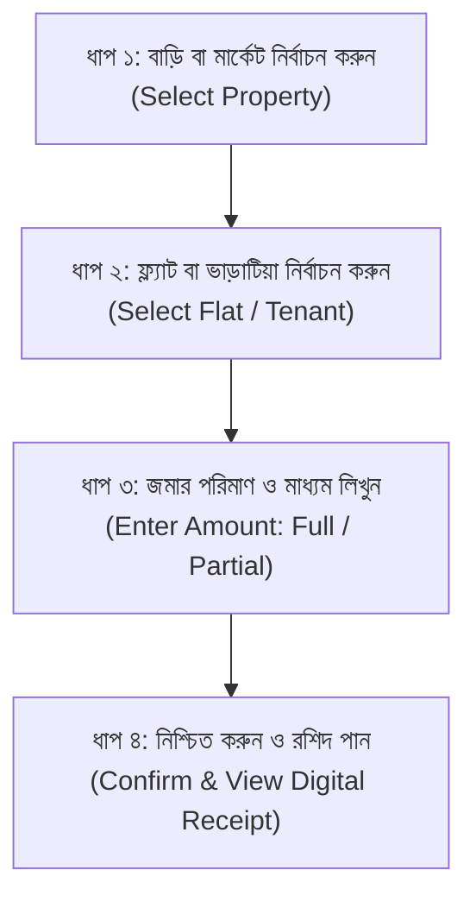

# Phase 10.1: Simple Mobile-First Bengali UI Redesign Plan
**Project Name**: ভূঁইয়া প্রপার্টি ম্যানেজার (Bhuiya Property Manager)  
**Location**: `C:\Bhuiya-Property-Manager`  
**Target Users**: 5 Family Members (Including Elderly Non-Technical Mother)  
**Design Philosophy**: "পারিবারিক হিসাবের সহজ ডিজিটাল খাতা" (Simple Digital Notebook for Family Accounts)  
**Audit Timestamp**: 2026-11-07  

---

## 1. Design Vision & Guiding Principles

The existing web interface was constructed with a complex 7-tab sidebar, dense multi-column desktop tables, and blue enterprise styling (`#2563eb`). While functional, it feels like complex corporate ERP software, creating an intimidating barrier for non-technical family members—particularly the user's mother.

The redesigned interface must transform into **a warm, clean, Bengali-first digital pocket ledger** that anyone in the family can understand and operate in seconds from their smartphone.

```
+-------------------------------------------------------------+
|                     TRADITIONAL ENTERPRISE ERP               |
|  - 7 Complex Sidebar Menus                                  |
|  - Microscopic Text & Dense Tables                          |
|  - 5-Step Nested Popups & Corporate Terminology             |
|  - Cold Blue Theme (#2563eb)                                |
+-------------------------------------------------------------+
                              ▼  TRANSFORM INTO
+-------------------------------------------------------------+
|                 সহজ পারিবারিক খাতা (FAMILY NOTEBOOK)       |
|  - Only 3 Bottom Navigation Tabs: [হোম] [হিসাব] [প্রোফাইল]  |
|  - Large, High-Contrast Bengali Typography (Hind Siliguri)   |
|  - 4 Bold Summary Cards & 4 Large Touch Buttons             |
|  - Fast 2-3 Step Touch Workflows                             |
|  - Clean White & Emerald Green Scheme (#059669 / #10b981)   |
+-------------------------------------------------------------+
```

### Core Design Rules:
1. **Bengali-First Language**: All labels, numbers, dates, error messages, and currency notations (`৳`) are presented in natural Bengali. English subtitles appear unobtrusively only where helpful.
2. **Clean White & Green Color Scheme**:
   - Primary: **Emerald Green** (`#059669` / `#10b981`) representing financial prosperity and trust.
   - Background: Pure White (`#ffffff`) and Soft Warm Slate (`#f8fafc`).
   - Accent / Alerts: Soft Amber (`#f59e0b`) for pending dues; Soft Rose (`#ef4444`) for expenses.
3. **Large Touch Targets**: All buttons, cards, and input fields are at least **48px to 56px in height** with generous spacing for effortless thumb navigation.
4. **No Hidden Calculations**: Financial metrics are presented simply: "আদায় - খরচ = ব্যালেন্স". Complex internal multi-tier distributions and ledger reconciliations happen seamlessly in the background.

---

## 2. Main Navigation Structure (The 3 Core Tabs)

The desktop sidebar is replaced on mobile devices by a fixed, accessible **Bottom Navigation Bar** containing only **3 items**:

```
+-------------------------------------------------------------+
|                                                             |
|                      [ ACTIVE SCREEN ]                      |
|                                                             |
+-------------------------------------------------------------+
|      [ 🏠 হোম ]           [ 📒 হিসাব ]         [ 👤 প্রোফাইল ]     |
|         Home                Accounts              Profile   |
+-------------------------------------------------------------+
```

1. **🏠 হোম (Home)**: The estate pulse at a glance. Shows current month revenue, dues, expenses, cash balance, and 4 one-tap Quick Action buttons.
2. **📒 হিসাব (Accounts)**: The monthly family ledger. Shows month-by-month income, expense breakdowns, family member distributions, and printable receipts.
3. **👤 প্রোফাইল (Profile)**: Member account details, family members list, permissions, category customization, and app settings.

---

## 3. Screen Specifications & User Experience

### 3.1 হোম (Home Screen)

Designed so any family member opening the app immediately understands the current month's financial standing:

```
+-------------------------------------------------------------+
|  ভূঁইয়া প্রপার্টি                                   [🔔] [📶]  |
|  কার্তিক-অগ্রহায়ণ ১৪৩২ • নভেম্বর ২০২৬                     |
+-------------------------------------------------------------+
|  ┌─────────────────────────┐  ┌──────────────────────────┐  |
|  │  এই মাসের মোট আদায়     │  │  বকেয়া ভাড়া            │  |
|  │  ৳ ১,৮৫,০০০             │  │  ৳ ২৫,০০০                │  |
|  │  (২১টি ইউনিটের ভাড়া)    │  │  (৩টি ইউনিট বকেয়া)      │  |
|  └─────────────────────────┘  └──────────────────────────┘  |
|  ┌─────────────────────────┐  ┌──────────────────────────┐  |
|  │  এই মাসের খরচ           │  │  বর্তমান ব্যালেন্স       │  |
|  │  ৳ ৩৫,০০০               │  │  ৳ ১,৫০,০০০              │  |
|  │  (রক্ষণাবেক্ষণ ও সেবা)  │  │  (বণ্টনের জন্য প্রস্তুত) │  |
|  └─────────────────────────┘  └──────────────────────────┘  |
+-------------------------------------------------------------+
|  ঝটপট অ্যাকশন (QUICK ACTIONS)                               |
|  ┌───────────────┐ ┌───────────────┐ ┌────────────────────┐ |
|  │  💰 ভাড়া জমা  │ │  📝 নতুন খরচ │ │  👥 ভাড়াটিয়া     │ |
|  └───────────────┘ └───────────────┘ └────────────────────┘ |
|  ┌─────────────────────────────┐                            |
|  │  📊 মাসিক পূর্ণাঙ্গ হিসাব   │                            |
|  └─────────────────────────────┘                            |
+-------------------------------------------------------------+
|  সাম্প্রতিক লেনদেন (RECENT ACTIVITY)                         |
|  • ফ্ল্যাট ৩-এ (রফিক সাহেব) - ভাড়া জমা: ৳১৮,০০০ (আজ)       |
|  • পানির পাম্প মেরামত খরচ - ৳৪,৫০০ (গতকাল)                   |
+-------------------------------------------------------------+
```

---

### 3.2 Simplified Rent Collection Workflow (ভাড়া জমা)

A streamlined **4-step touch workflow** that takes less than 15 seconds to complete on a smartphone:



#### Screen Details:
- **Step 1**: Big cards showing property names (ভূঁইয়া বাড়ি, মিতালী মার্কেট, এন.এম. ভূঁইয়া টাওয়ার).
- **Step 2**: List of tenants with outstanding dues clearly marked in amber badges.
- **Step 3**: Amount input pre-filled with the exact balance due. One-tap quick buttons for payment method:
  `[নগদ (Cash)]` `[বিকাশ (bKash)]` `[ব্যাংক (Bank)]` `[নগদ (Nagad)]`.
- **Step 4**: Green confirmation button (`[টাকা জমা সংরক্ষণ করুন]`). Instantly generates a clean Bengali digital receipt with a one-tap WhatsApp share button.

---

### 3.3 Simplified Expense Entry (নতুন খরচ)

Single-screen quick entry for everyday property or family expenses:

1. **বিবরণ (Description)**: e.g. "পানির পাম্প মেরামত" বা "বাজার সদাই".
2. **টাকার পরিমাণ (Amount)**: Large touch number field.
3. **খাতের ধরন (Category Chips)**: Tap-friendly pill buttons:
   - `[বিদ্যুৎ বিল]` `[পানি বিল]` `[কেয়ারটেকার বেতন]` `[মেরামত]` `[পারিবারিক বাজার]` `[অন্যান্য]`
4. **প্রপার্টি (Property)**: Optional toggle (ভূঁইয়া বাড়ি / মিতালী মার্কেট / টাওয়ার / পারিবারিক).
5. **সংরক্ষণ করুন (Save)**: Large touch button.

---

### 3.4 হিসাব (Accounts & Monthly Ledger Screen)

A clean, transparent monthly overview:

- **মাস নির্বাচন (Month Selector)**: Left/right arrow navigation (`◀ অক্টোবর ২০২৬ | নভেম্বর ২০২৬ ▶`).
- **আদায় ও খরচ সামারি (Income vs Expense)**:
  - মোট সংগৃহীত ভাড়া: **৳ ১,৮৫,০০০**
  - মোট ভবনের খরচ: **৳ ৩০,০০০**
  - পারিবারিক খরচ: **৳ ২০,০০০**
  - **নেট বণ্টনযোগ্য উদ্বৃত্ত**: **৳ ১,৩৫,০০০**
- **পারিবারিক অংশীদারদের পাওনা (Family Payouts)**:
  - বড় ভাই (৳৪৫,০০০): `[পরিশোধিত]`
  - মেজ ভাই (৳৪৫,০০০): `[পরিশোধিত]`
  - ছোট ভাই (৳৪৫,০০০): `[পরিশোধিত]`
  - আম্মা (৳২৫,০০০): `[পরিশোধিত]`
  - বোন (৳২৫,০০০): `[বকেয়া]`
- **রিজার্ভ ফান্ড জমা (Emergency Fund)**: চলতি মাসের অবণ্টিত উদ্বৃত্ত স্বয়ংক্রিয়ভাবে বা ম্যানুয়ালি রিজার্ভ ফান্ডে স্থানান্তরের সুবিধা।

---

### 3.5 প্রোফাইল (Profile & Family Workspace Management)

- **ব্যবহারকারীর তথ্য (User Info)**: নাম, ইমেইল, পদবী (`মাস্টার এডমিন` বা `পারিবারিক সদস্য`).
- **পারিবারিক সদস্য ব্যবস্থাপনা (Family Members - Admin Only)**:
  - ৫ জন সদস্যের তালিকা ও তাদের মোবাইল লগইন স্ট্যাটাস।
  - নতুন সদস্য যুক্ত করা ও অনুমতি (Permissions) পরিবর্তন করা।
  - এক ক্লিকে যেকোনো সদস্যের অ্যাকাউন্ট সক্রিয়/নিষ্ক্রিয় (Active/Deactivate) করার নিরাপত্তা সুইচ।
- **মেনু ও অ্যাকশন কাস্টমাইজেশন (Customization - Admin Only)**:
  - অপ্রয়োজনীয় অপশন বা বোতাম লুকানো (Hide/Show) বা আগে-পরে সাজানো।
  - লুকানো অপশনে থাকা কোনো আর্থিক তথ্য মুছে যাবে না।
- **অফলাইন স্ট্যাটাস ও লগআউট (Offline Status & Logout)**.

---

## 4. Mobile Responsiveness & Touch Optimization

| Feature | Technical Implementation |
|---|---|
| **Viewport & Scaling** | `<meta name="viewport" content="width=device-width, initial-scale=1.0, maximum-scale=1.0, user-scalable=no, viewport-fit=cover">` |
| **Touch Targets** | All interactive elements enforce `min-height: 48px`, `touch-action: manipulation`, with active tap feedback (`active:scale-98`). |
| **Bengali Typography** | Google Font `Hind Siliguri` (400, 500, 600, 700) loaded locally via static assets to guarantee zero network lag on mobile. |
| **Safe Area Insets** | `padding-bottom: env(safe-area-inset-bottom)` to prevent navigation overlap on iPhones with Home Indicators. |
| **Modal Experience** | Modals slide up smoothly from the bottom (`bottom-sheet` UX) on mobile screens for natural thumb reachability. |

---

## 5. PWA (Progressive Web App) Mobile Experience

### 5.1 Manifest & Visual Integration
- `name`: "ভূঁইয়া প্রপার্টি ম্যানেজার"
- `short_name`: "ভূঁইয়া প্রপার্টি"
- `theme_color`: `#059669` (Emerald Green)
- `background_color`: `#f8fafc`
- `display`: `standalone`
- App Icons: Maskable SVG and high-resolution icons (192px and 512px).
- Add-to-Home-Screen prompt configured for Android Chrome and iOS Safari.

### 5.2 Offline Behavior & Financial Safety
- **Static Shell Caching**: The HTML shell, stylesheets, scripts, and Bengali fonts are pre-cached by `sw.js` for instant cold starts even without an active internet connection.
- **Offline Mutation Protection**:
  - The app strictly prohibits recording rent payments, expenses, or payouts when offline.
  - If a user loses connectivity, an unobtrusive warm amber banner appears:
    `"⚠️ ইন্টারনেট সংযোগ বিচ্ছিন্ন। হিসাবের সুরক্ষার জন্য অফলাইনে টাকা জমা করা সাময়িকভাবে বন্ধ আছে।"`
  - Mutation submit buttons are disabled with clear Bengali guidance, completely preventing accidental duplicate submissions or lost transactions.
  - When connection is restored, the banner turns green (`"✅ ইন্টারনেট সংযোগ ফিরে এসেছে"`) and inputs are re-enabled.

---

## 6. Phased Implementation Roadmap

1. **Step 1: Design System & Color Tokens**: Migrate Tailwind tokens from enterprise blue (`blue-600`) to warm white and emerald green (`emerald-600`).
2. **Step 2: Bottom Navigation Bar Component**: Build the 3-item fixed mobile bottom navigation (`হোম`, `হিসাব`, `প্রোফাইল`).
3. **Step 3: Mobile Home View**: Replace the desktop overview with the 4 essential cards and 4 big touch quick actions.
4. **Step 4: Simplified Workflows**: Implement bottom-sheet touch modals for Rent Collection (`ভাড়া জমা`) and Expense Entry (`নতুন খরচ`).
5. **Step 5: Family Accounts View**: Render the clean monthly ledger with family beneficiary payouts.
6. **Step 6: PWA Polish**: Update theme colors, manifest, and offline safeguards.
