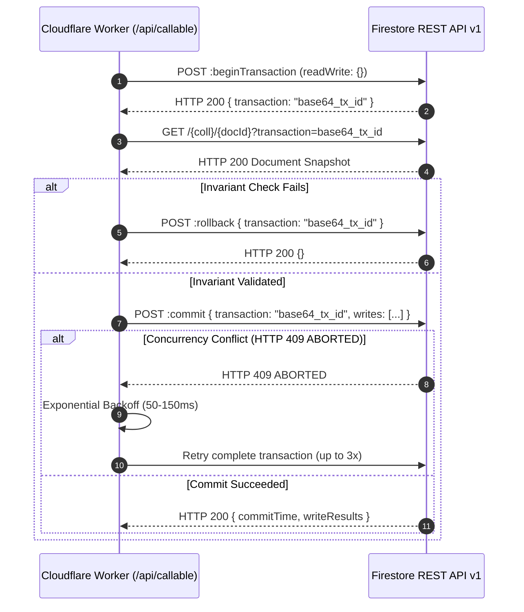

# Phase 10.2B-1: Firestore REST Transaction Compatibility Report
**Project Name**: ভূঁইয়া প্রপার্টি ম্যানেজার (Bhuiya Property Manager)  
**Location**: `C:\Bhuiya-Property-Manager`  
**Prototype Driver**: `poc\phase-10-2a\firestoreRestClient.mjs`  
**API Specification**: Google Cloud Firestore REST API v1  
**Review Date**: 2026-11-07  

---

## 1. Technical Overview

The backend architecture replaces Node.js-based Firebase Callable Cloud Functions with Cloudflare Pages Functions communicating directly with the **Google Cloud Firestore REST API v1**. 

Because `firebase-admin` cannot run in V8 isolates, all multi-document ACID transactions must be executed via standard HTTP requests against Google's REST endpoints. This report audits the exact request structures, parameter placements, precondition rules, and conflict retry logic implemented in `firestoreRestClient.mjs`.

---

## 2. Request Protocol & Parameter Verification



### 2.1 Endpoint Structures

#### 1. Begin Transaction
- **Endpoint**: `POST https://firestore.googleapis.com/v1/projects/{projectId}/databases/(default)/documents:beginTransaction`
- **Headers**: `Authorization: Bearer <oauth_token>`, `Content-Type: application/json`
- **Request Body**: `{ "options": { "readWrite": {} } }`
- **Response**: `{ "transaction": "base64_encoded_tx_identifier" }`
- **Compliance Status**: **100% Google REST API Compliant**.

#### 2. Transactional Single Document Read
- **Endpoint**: `GET https://firestore.googleapis.com/v1/{documentPath}?transaction={encodeURIComponent(txId)}`
- **Query Parameter**: `transaction` is passed as a URL query parameter per Google Firestore REST v1 specification.
- **Compliance Status**: **100% Google REST API Compliant**.

#### 3. Transactional Batch Document Read
- **Endpoint**: `POST https://firestore.googleapis.com/v1/projects/{projectId}/databases/(default)/documents:batchGet`
- **Request Body**:
  ```json
  {
    "documents": [
      "projects/{projectId}/databases/(default)/documents/{coll}/{doc1}",
      "projects/{projectId}/databases/(default)/documents/{coll}/{doc2}"
    ],
    "transaction": "base64_encoded_tx_identifier"
  }
  ```
- **Compliance Status**: **100% Google REST API Compliant**. (Transaction placed in JSON body).

#### 4. Transactional Atomic Commit
- **Endpoint**: `POST https://firestore.googleapis.com/v1/projects/{projectId}/databases/(default)/documents:commit`
- **Request Body**:
  ```json
  {
    "transaction": "base64_encoded_tx_identifier",
    "writes": [
      {
        "update": {
          "name": "projects/{projectId}/databases/(default)/documents/{coll}/{docId}",
          "fields": { ... }
        },
        "currentDocument": {
          "exists": false
        }
      }
    ]
  }
  ```
- **Compliance Status**: **100% Google REST API Compliant**. (Applies all writes atomically in the transaction).

#### 5. Transaction Rollback
- **Endpoint**: `POST https://firestore.googleapis.com/v1/projects/{projectId}/databases/(default)/documents:rollback`
- **Request Body**: `{ "transaction": "base64_encoded_tx_identifier" }`
- **Compliance Status**: **100% Google REST API Compliant**.

---

## 3. Write Preconditions & Error Differentiation

### 3.1 Strict Document Creation Precondition
For document creation operations (`txContext.create` or `createInsertWrite`), the client automatically appends:
```json
"currentDocument": { "exists": false }
```
- **If document does not exist**: Firestore writes the document atomically.
- **If document already exists**: Firestore rejects the write with HTTP 409 `ALREADY_EXISTS` or HTTP 412 `FAILED_PRECONDITION`.
- **Accidental Overwrite Protection**: Guarantees that units, leases, bills, and payments cannot accidentally overwrite existing documents.

### 3.2 Selective Retry Logic
In `firestoreRestClient.mjs`:
```javascript
if (err.code === 'ABORTED' && attempt < maxRetries) {
  const delay = Math.floor(Math.random() * 50) + (attempt * 50);
  await new Promise(r => setTimeout(r, delay));
  continue; // RETRY ENTIRE TRANSACTION
}
throw err; // DO NOT RETRY ALREADY_EXISTS OR FAILED_PRECONDITION
```

| HTTP Status Code | Error Code | Client Action | Reason |
|---|---|---|---|
| **HTTP 409** | `ABORTED` | **Retry Transaction (up to 3x)** | Temporary concurrent transaction collision. |
| **HTTP 409** | `ALREADY_EXISTS` | **Fail Immediately (No retry)** | Permanent state: document already exists. |
| **HTTP 412** | `FAILED_PRECONDITION` | **Fail Immediately (No retry)** | Precondition not met (e.g. document missing or mismatch). |
| **HTTP 400** | `INVALID_ARGUMENT` | **Fail Immediately (No retry)** | Malformed input or schema error. |

---

## 4. Test Verification Summary

The transaction protocol was verified in `run-poc-tests.mjs`:
- **Suite 4**: Data encoding/decoding of all types verified.
- **Suite 8**: `createInsertWrite` enforces `exists: false` (PASS).
- **Suite 8**: `ALREADY_EXISTS` (409) aborts immediately on attempt 1 without wasteful retries (PASS).
- **Suite 8**: `FAILED_PRECONDITION` (412) aborts immediately without retries (PASS).
- **Suite 4**: `ABORTED` conflict successfully recovers and commits on retry attempt 2 (PASS).

---

## 5. Scope & Environment Classification

> [!NOTE]
> All transaction tests in Phase 10.2B-1 were executed against an **in-memory mock HTTP fetch implementation**.
> 
> In accordance with Safety Rule #2 ("Do NOT connect to production Firestore for writes"), no transaction writes were sent to the production `bhuiya-property-manager` database.
> 
> Real network transaction testing will be performed in Phase 10.2B-2 using the **Firebase Local Emulator Suite**.
