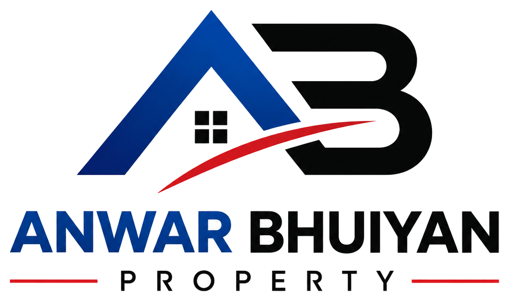

# আনোয়ার ভূঁইয়া প্রপার্টি (Anwar Bhuiyan Property Manager)

<p align="center">
  
</p>

<p align="center">
  <strong>পারিবারিক ডিজিটাল প্রপার্টি ও আর্থিক খাতা (Family Property & Financial Ledger System)</strong>
</p>

<p align="center">
  <a href="https://iamzahid.pages.dev/"></a>
  <a href="https://iamzahid.pages.dev/download/"></a>
  <a href="https://github.com/iamzahidhb-netizen/Bhuiya-Property-Manager/releases/latest"></a>
</p>

---

## 📌 সারসংক্ষেপ (Overview)

**আনোয়ার ভূঁইয়া প্রপার্টি** একটি আধুনিক, সুরক্ষিত এবং সম্পূর্ণ স্বয়ংক্রিয় পারিবারিক প্রপার্টি ও আর্থিক ব্যবস্থাপনা সিস্টেম। ভবন ও ফ্ল্যাটের ভাড়া আদায়, রক্ষণাবেক্ষণ খরচ লিপিবদ্ধকরণ, ভাইদের মধ্যে মাসিক পারিবারিক মুনাফা বণ্টন এবং রিয়েল-টাইম হিসাব সংরক্ষণের জন্য এটি বিশেষভাবে তৈরি করা হয়েছে।

অ্যাপ্লিকেশনটি ওয়েব ব্রাউজার এবং অ্যান্ড্রয়েড নেটিভ উভয় প্ল্যাটফর্মেই **Xiaomi HyperOS 2.0** ডিজাইন সিস্টেমের ফ্লুইড অভিজ্ঞতায় পরিচালিত হয়।

---

## 🚀 সরাসরি ডাউনলোড ও ব্যবহারের লিঙ্ক (Quick Links)

- 🌐 **লাইভ ওয়েব প্ল্যাটফর্ম:** [https://iamzahid.pages.dev/](https://iamzahid.pages.dev/)
- 📱 **সরাসরি Android APK ডাউনলোড:** [bhuiya-property-manager.apk](https://iamzahid.pages.dev/bhuiya-property-manager.apk)
- 📥 **APK ডাউনলোড পোর্টাল:** [https://iamzahid.pages.dev/download/](https://iamzahid.pages.dev/download/)
- 🏷️ **GitHub রিলিজ পেজ:** [GitHub Releases](https://github.com/iamzahidhb-netizen/Bhuiya-Property-Manager/releases)

---

## ✨ প্রধান বৈশিষ্ট্যসমূহ (Core Features)

### 📱 ১. Xiaomi HyperOS 2.0 মোবাইল ডিজাইন সিস্টেম
- **ফ্লোটিং পিল নেভিগেশন (`FloatingPillNav`):** স্ক্রিনের নিচে আধুনিক ভাসমান ফ্লিপ-পিল কন্ট্রোল ডক, যার মাধ্যমে এক ট্যাপে হোম, হিসাব, নতুন খরচ, ভাড়া জমা এবং প্রোফাইল সেকশনে যাতায়াত করা যায়।
- **রেসপনসিভ ও কমপ্যাক্ট লেআউট:** স্মার্টফোনের উল্লম্ব স্ক্রিন রেশিও এবং কীবোর্ড ওপেন থাকলে ইনপুট বক্স ঢেকে না যাওয়ার জন্য ইন্টেলিজেন্ট ভিউপোর্ট স্ক্রোল।
- **সিনেমাটিক ওপেনিং অ্যানিমেশন:** ইউটিউব স্টাইলের মাল্টি-স্টেজ ব্র্যান্ডিং রিভিল স্প্ল্যাশ অ্যানিমেশন।

### 🌙 ২. অ্যাডভান্সড ডার্ক মোড ও স্ট্যাটাসবার সমন্বয়
- **স্মার্ট স্ট্যাটাসবার ট্রানজিশন:** অ্যান্ড্রয়েড নেটিভ `MainActivity` এবং `values-night` স্টাইলের সাথে রিয়েল-টাইম থিম সিঙ্ক।
- **হাইপারকার্ড ডার্ক সারফেস:** ডার্ক মোডে হিসাবের সব কার্ড স্বয়ংক্রিয়ভাবে স্লিম ডার্ক সারফেসে স্পষ্ট ও পাঠযোগ্য কালারে প্রদর্শিত হয়।

### 💰 ৩. সম্পূর্ণ আর্থিক খাতা ও ভাউচার ট্র্যাকিং
- **ভাড়া আদায় ও রসিদ (Rent Collection):** প্রতিটি ফ্ল্যাটের ভাড়া আদায়, বকেয়া ট্র্যাকিং এবং ডিজিটাল ক্যাশ মেমো রেফারেন্স।
- **রক্ষণাবেক্ষণ ও খরচ (Building Maintenance):** বিদ্যুৎ বিল, পানির মোটর মেরামত, সিকিউরিটি ও কেয়ারটেকার বেতন ইত্যাদির বিস্তারিত ভাউচার।
- **পারিবারিক বণ্টন ও রিজার্ভ (Family Distribution):** মাসের মোট আদায় থেকে খরচ বাদ দিয়ে ভাইদের নির্ধারিত হারে পারিবারিক মুনাফা স্বয়ংক্রিয় গণনা ও রিজার্ভ ফান্ড স্থানান্তর।

### 👥 ৪. সদস্য ব্যবস্থাপনা ও ভূমিকা নিয়ন্ত্রণ (RBAC)
- **মাস্টার অ্যাডমিন (Master Admin):** সম্পূর্ণ সিস্টেম নিয়ন্ত্রণ, নতুন সদস্য অনুমোদন ও আর্থিক ভাউচার অনুমোদন।
- **ম্যানেজার (Property Manager):** দৈনন্দিন ভাড়া আদায় ও ভবনের খরচ এন্ট্রি।
- **দর্শক (Family Viewer):** পারিবারিক স্বচ্ছতার জন্য শুধুমাত্র হিসাব ও অডিট রিপোর্ট দেখার অনুমতি (রিড-অনলি)।

### 🖼️ ৫. প্রোফাইল ও ফটো ম্যানেজমেন্ট
- সরাসরি গ্যালারি বা ক্যামেরা থেকে ছবি আপলোড, ইনস্ট্যান্ট ব্রাউজার ক্রপিং, কম্প্রেসন এবং ক্লাউড স্টোরেজে রিয়েল-টাইম সিঙ্ক্রোনাইজেশন।

---

## 🛠️ প্রযুক্তিগত কাঠামো (Technology Stack)

| স্তর (Layer) | ব্যবহৃত প্রযুক্তি (Technologies) |
| :--- | :--- |
| **Frontend Framework** | React 19, TypeScript, Vite |
| **Mobile Runtime** | Capacitor 7 (Android Target SDK 35, Java 17) |
| **Styling & Design System** | Tailwind CSS v4, HyperOS Token Architecture, Lucide Icons |
| **Edge Serverless Backend** | Cloudflare Pages Advanced Mode Worker (`_worker.js`, Web Crypto RS256) |
| **Database & Auth** | Google Firebase Firestore (Realtime Listeners), Firebase Authentication |
| **Deployment Platform** | Cloudflare Pages Global CDN Edge Network |

---

## 📲 অ্যান্ড্রয়েড ফোনে ইনস্টলেশন নির্দেশিকা (Android Installation Guide)

১. আপনার মোবাইল ব্রাউজার থেকে **[APK ডাউনলোড লিঙ্ক](https://iamzahid.pages.dev/bhuiya-property-manager.apk)** ওপেন করুন।
২. ডাউনলোড সম্পন্ন হলে ফাইলে ট্যাপ করে ইনস্টল নিশ্চিত করুন (প্রয়োজনে *Install Unknown Apps* অনুমোদন দিন)।
৩. অ্যাপ ওপেন করে আপনার অনুমোদিত ইমেইল ও পাসওয়ার্ড দিয়ে লগইন করুন।

---

## 💻 লোকাল ডেভেলপমেন্ট সেটআপ (Local Setup)

```bash
# ১. রিপোজিটরি ক্লোন করুন
git clone https://github.com/iamzahidhb-netizen/Bhuiya-Property-Manager.git
cd Bhuiya-Property-Manager

# ২. ডিপেন্ডেন্সি ইনস্টল করুন
npm install

# ৩. লোকাল ডেভেলপমেন্ট সার্ভার চালু করুন
npm run dev

# ৪. প্রোডাকশন ওয়েব বিল্ড ও ওয়ার্কার প্যাকেজিং
npm run build

# ৫. অ্যান্ড্রয়েড নেটিভ প্রজেক্ট সিঙ্ক করুন
npx cap sync android

# ৬. অ্যান্ড্রয়েড ডিবাগ APK তৈরি করুন
cd android
./gradlew assembleDebug
```

---

## 📄 লাইসেন্স ও কপিরাইট (License)

© 2026 **আনোয়ার ভূঁইয়া প্রপার্টি** (Anwar Bhuiyan Property Manager). সর্বস্বত্ব সংরক্ষিত।
মাস্টার অ্যাডমিন: **জাহিদ ভূঁইয়া (Zahid Bhuiyan)**
