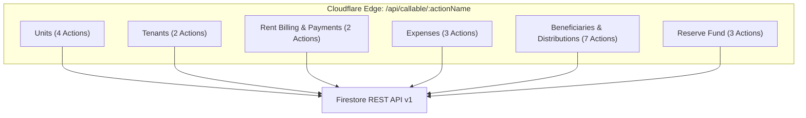

# Phase 10.2A: Function Migration Mapping & Endpoint Specifications
**Project Name**: ভূঁইয়া প্রপার্টি ম্যানেজার (Bhuiya Property Manager)  
**Location**: `C:\Bhuiya-Property-Manager\poc\phase-10-2a`  
**Target Routing**: Cloudflare Pages Advanced Mode (`/api/callable/:actionName`)  
**Backend Driver**: Cloud Firestore REST API v1  
**Audit Timestamp**: 2026-11-07  

---

## 1. Migration Protocol & Architecture Standard

Every existing Firebase Callable Function maps directly to a Cloudflare Pages Functions endpoint over HTTPS:

- **Protocol**: `POST /api/callable/:actionName`
- **Request Headers**:
  - `Authorization: Bearer <firebase_id_token>` (Mandatory)
  - `Content-Type: application/json`
- **Response Format**: `{ data: { ... }, status: 200 }` (Maintains 100% compatibility with frontend `apiClient.ts` wrapper)
- **Error Format**: `{ error: { code: string, message: string } }` with appropriate HTTP status codes (400, 401, 403, 404, 409, 412, 500).

---

## 2. Comprehensive Function Inventory & Endpoint Specifications

---

### GROUP 1: UNITS & PROPERTY LIFECYCLE (4 Functions)

| Function # | Function Name | Method & Proposed Endpoint | Auth & RBAC Requirement | Firestore Operations | Transaction Requirements | Idempotency Strategy | Migration Difficulty | Key Technical Risks |
|---|---|---|---|---|---|---|---|---|
| **01** | `createUnitCallable` | `POST /api/callable/createUnitCallable` | Verified ID Token; `master_admin` or `canManageTenants` | `GET properties/{id}`, `CREATE units/{id}`, `UPDATE properties/{id}` | **ACID Transaction** (Read parent property, verify unique normalized unit, write unit, update active unit map) | Unique unit ID generated on server; normalized unit collision rejects duplicate | Low | Normalized string collation differences between JavaScript and database. |
| **02** | `renameUnitCallable` | `POST /api/callable/renameUnitCallable` | Verified ID Token; `master_admin` or `canManageTenants` | `GET units/{id}`, `GET properties/{id}`, `UPDATE units/{id}`, `UPDATE properties/{id}` | **ACID Transaction** (Atomic transfer of unit uniqueness reservation in parent doc) | Atomic property map update; duplicate target number rejected | Low | Renaming active unit with ongoing lease requires atomic foreign key updates. |
| **03** | `archiveUnitCallable` | `POST /api/callable/archiveUnitCallable` | Verified ID Token; `master_admin` only | `GET units/{id}`, `UPDATE units/{id}`, `UPDATE properties/{id}` | **ACID Transaction** (Verifies `status == 'vacant'` before archiving) | Idempotent toggle (`isArchived: true`) | Low | Attempting to archive an occupied unit must fail with HTTP 412. |
| **04** | `restoreUnitCallable` | `POST /api/callable/restoreUnitCallable` | Verified ID Token; `master_admin` only | `GET units/{id}`, `GET properties/{id}`, `UPDATE units/{id}`, `UPDATE properties/{id}` | **ACID Transaction** (Re-validates uniqueness before unarchiving) | Idempotent toggle (`isArchived: false`) | Low | Unit number might have been taken by another unit while archived. |

---

### GROUP 2: TENANTS & LEASE MANAGEMENT (2 Functions)

| Function # | Function Name | Method & Proposed Endpoint | Auth & RBAC Requirement | Firestore Operations | Transaction Requirements | Idempotency Strategy | Migration Difficulty | Key Technical Risks |
|---|---|---|---|---|---|---|---|---|
| **05** | `registerTenantCallable` | `POST /api/callable/registerTenantCallable` | Verified ID Token; `master_admin` or `canManageTenants` | `GET units/{id}`, `CREATE tenants/{id}`, `UPDATE units/{id}`, `CREATE security_deposits/{id}` | **ACID Multi-Document Transaction** (Unit occupancy check + tenant creation + deposit liability) | Deterministic unit occupancy check; fails if unit already occupied | Medium | Deposit liability must never be counted as rental income. |
| **06** | `vacateTenantCallable` | `POST /api/callable/vacateTenantCallable` | Verified ID Token; `master_admin` or `canManageTenants` | `GET tenants/{id}`, `GET units/{id}`, `UPDATE tenants/{id}`, `UPDATE units/{id}`, `UPDATE security_deposits/{id}` | **ACID Multi-Document Transaction** (Tenant vacate + unit restore to vacant + deposit refund settlement) | Deterministic status check; fails if tenant already vacated | Medium | Net refund calculation must deduct damages from deposit liability without posting to operating expenses. |

---

### GROUP 3: RENT BILLING & PAYMENTS (2 Functions)

| Function # | Function Name | Method & Proposed Endpoint | Auth & RBAC Requirement | Firestore Operations | Transaction Requirements | Idempotency Strategy | Migration Difficulty | Key Technical Risks |
|---|---|---|---|---|---|---|---|---|
| **07** | `generateMonthlyBillsCallable` | `POST /api/callable/generateMonthlyBillsCallable` | Verified ID Token; `master_admin` or `canCollectRent` | `GET tenants`, `BATCH CREATE rent_bills` | **Atomic Batch Commit** (Writes all active tenant bills atomically via `:commit`) | Deterministic document ID: `${propertyId}_${unitId}_${billingMonth}`. Existing bills skipped. | Medium | Large properties (>50 units) require chunking batch writes within the 500-write REST limit. |
| **08** | `recordRentPaymentCallable` | `POST /api/callable/recordRentPaymentCallable` | Verified ID Token; `master_admin` or `canCollectRent` | `GET rent_bills/{id}`, `UPDATE rent_bills/{id}`, `CREATE rent_payments/{id}` | **ACID Transaction** (Read bill balanceDue, verify payment <= due, update totalPaid, write receipt) | Unique payment ID passed or server-generated UUID; duplicate submission rejected | Medium | Concurrent payments against the same bill could over-allocate without ACID transaction locks. |

---

### GROUP 4: OPERATING EXPENSES & AUDIT TRAILS (3 Functions)

| Function # | Function Name | Method & Proposed Endpoint | Auth & RBAC Requirement | Firestore Operations | Transaction Requirements | Idempotency Strategy | Migration Difficulty | Key Technical Risks |
|---|---|---|---|---|---|---|---|---|
| **09** | `createExpenseCallable` | `POST /api/callable/createExpenseCallable` | Verified ID Token; `master_admin` or `canRecordExpenses` | `CREATE expenses/{id}` | Non-transactional single-document write | Client request deduplication key or server UUID | Low | Missing or unclassified expense group (building vs. family). |
| **10** | `updateExpenseCallable` | `POST /api/callable/updateExpenseCallable` | Verified ID Token; `master_admin` only | `GET expenses/{id}`, `UPDATE expenses/{id}` | **ACID Transaction** (Reads previous state, appends to `auditHistory`, updates amount/desc) | Updates existing document by ID | Low | Modifying historical expense without capturing mandatory justification reason. |
| **11** | `reverseExpenseCallable` | `POST /api/callable/reverseExpenseCallable` | Verified ID Token; `master_admin` only | `GET expenses/{id}`, `UPDATE expenses/{id}` | **ACID Transaction** (Sets `status: 'reversed'`, logs reason, timestamp, editor UID) | Idempotent status check; fails if already reversed | Low | Must strictly update status; hard deletion is prohibited by financial integrity rules. |

---

### GROUP 5: FAMILY BENEFICIARIES & DISTRIBUTIONS (7 Functions)

| Function # | Function Name | Method & Proposed Endpoint | Auth & RBAC Requirement | Firestore Operations | Transaction Requirements | Idempotency Strategy | Migration Difficulty | Key Technical Risks |
|---|---|---|---|---|---|---|---|---|
| **12** | `seedDefaultBeneficiariesCallable` | `POST /api/callable/seedDefaultBeneficiariesCallable` | Verified ID Token; `master_admin` only | `GET beneficiaries`, `BATCH CREATE beneficiaries` | **Atomic Batch Commit** | Deterministic doc ID `ben_${workspaceId}_${code}`; existing records skipped | Low | Re-seeding must not overwrite modified custom beneficiary target amounts. |
| **13** | `createBeneficiaryCallable` | `POST /api/callable/createBeneficiaryCallable` | Verified ID Token; `master_admin` only | `CREATE beneficiaries/{id}` | Single document write | Unique beneficiary identifier | Low | Target amount must be positive. |
| **14** | `updateBeneficiaryCallable` | `POST /api/callable/updateBeneficiaryCallable` | Verified ID Token; `master_admin` only | `GET beneficiaries/{id}`, `UPDATE beneficiaries/{id}` | Single document update | Updates existing document | Low | Retroactive alteration of historical distribution snapshots must be prevented. |
| **15** | `archiveBeneficiaryCallable` | `POST /api/callable/archiveBeneficiaryCallable` | Verified ID Token; `master_admin` only | `UPDATE beneficiaries/{id}` | Single document update | Idempotent toggle (`isArchived: true`) | Low | Preserves past payout history. |
| **16** | `getOrCreateMonthlyDistributionCallable` | `POST /api/callable/getOrCreateMonthlyDistributionCallable` | Verified ID Token; any active family member | `GET family_distributions/{id}`, `GET beneficiaries`, `CREATE family_distributions/{id}` | **ACID Transaction** (Reads month snapshot; if missing, freezes current active beneficiaries) | Deterministic doc ID `${workspaceId}_${month}` | Medium | Concurrency when multiple family members open the accounts tab on the 1st of the month. |
| **17** | `applySpecialAdjustmentCallable` | `POST /api/callable/applySpecialAdjustmentCallable` | Verified ID Token; `master_admin` only | `GET family_distributions/{id}`, `UPDATE family_distributions/{id}` | **ACID Transaction** (Applies one-off adjustment to snapshot target with mandatory reason) | Document update with audit reason | Medium | Adjustments must adjust target without altering previous payouts. |
| **18** | `recordBeneficiaryPayoutCallable` | `POST /api/callable/recordBeneficiaryPayoutCallable` | Verified ID Token; `master_admin` only | `GET family_distributions/{id}`, `UPDATE family_distributions/{id}` | **ACID Transaction** (Records payout amount, updates totalPaid, decrements remaining due) | Idempotent transaction; duplicate payment ID rejected | Medium | Double payout recording or payout exceeding remaining monthly target. |

---

### GROUP 6: FAMILY RESERVE FUND (3 Functions)

| Function # | Function Name | Method & Proposed Endpoint | Auth & RBAC Requirement | Firestore Operations | Transaction Requirements | Idempotency Strategy | Migration Difficulty | Key Technical Risks |
|---|---|---|---|---|---|---|---|---|
| **19** | `initializeReserveFundCallable` | `POST /api/callable/initializeReserveFundCallable` | Verified ID Token; `master_admin` only | `CREATE reserve_funds/{id}`, `CREATE reserve_ledger/{id}` | **ACID Multi-Document Transaction** (Initializes fund doc & opening balance ledger entry) | Deterministic doc ID `reserve_funds/${workspaceId}`; fails if already initialized | Low | Re-initialization could reset accumulated reserve balance. |
| **20** | `withdrawFromReserveCallable` | `POST /api/callable/withdrawFromReserveCallable` | Verified ID Token; `master_admin` only | `GET reserve_funds/{id}`, `UPDATE reserve_funds/{id}`, `CREATE reserve_ledger/{id}` | **ACID Multi-Document Transaction** (Verifies balance >= amount, updates balance, appends ledger) | Balance check prevents duplicate deduction | Medium | Overdraft / balance becoming negative; marking withdrawal as rental income (strictly prohibited). |
| **21** | `transferSurplusToReserveCallable` | `POST /api/callable/transferSurplusToReserveCallable` | Verified ID Token; `master_admin` only | `GET reserve_funds/{id}`, `UPDATE reserve_funds/{id}`, `CREATE reserve_ledger/{id}` | **ACID Multi-Document Transaction** (Appends surplus transfer to ledger, increments balance) | Transactional balance increment | Medium | Monthly surplus transferred more than once for the same billing month. |

---

## 3. Frontend Service Mapping Summary

All 21 functions are called through the existing frontend abstraction `src/lib/apiClient.ts`:
- **`propertyService.ts`**: Calls functions 01, 02, 03, 04.
- **`tenantService.ts`**: Calls functions 05, 06.
- **`rentService.ts`**: Calls functions 07, 08.
- **`expenseService.ts`**: Calls functions 09, 10, 11.
- **`distributionService.ts`**: Calls functions 12, 13, 14, 15, 16, 17, 18 (Distributions) & 19, 20, 21 (Reserve Fund).

**Zero Frontend Rework Required**: Because `apiClient.ts` already dispatches to `POST /api/callable/${actionName}` and passes the Firebase ID token in the `Authorization: Bearer` header, the frontend service layer is **100% compatible** with this Cloudflare endpoint routing mapping.
